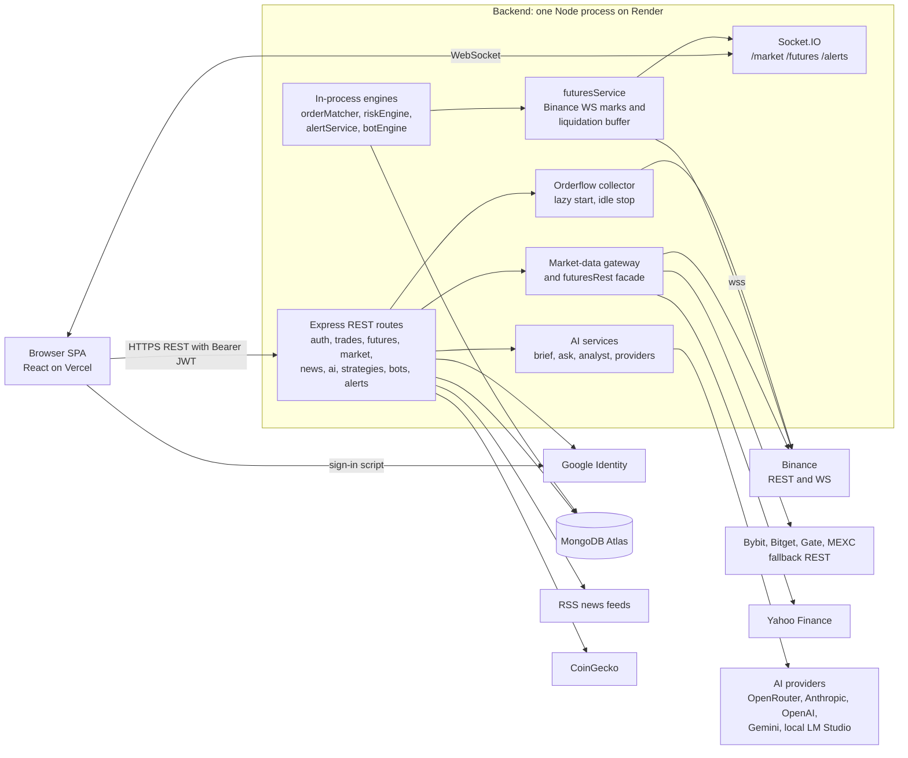
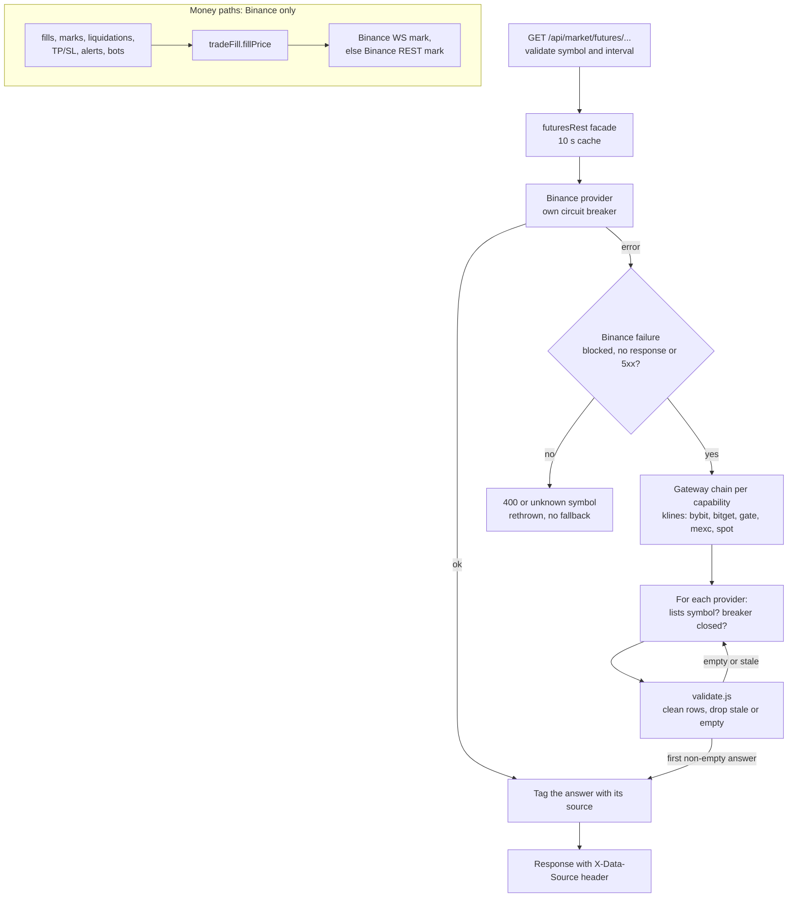
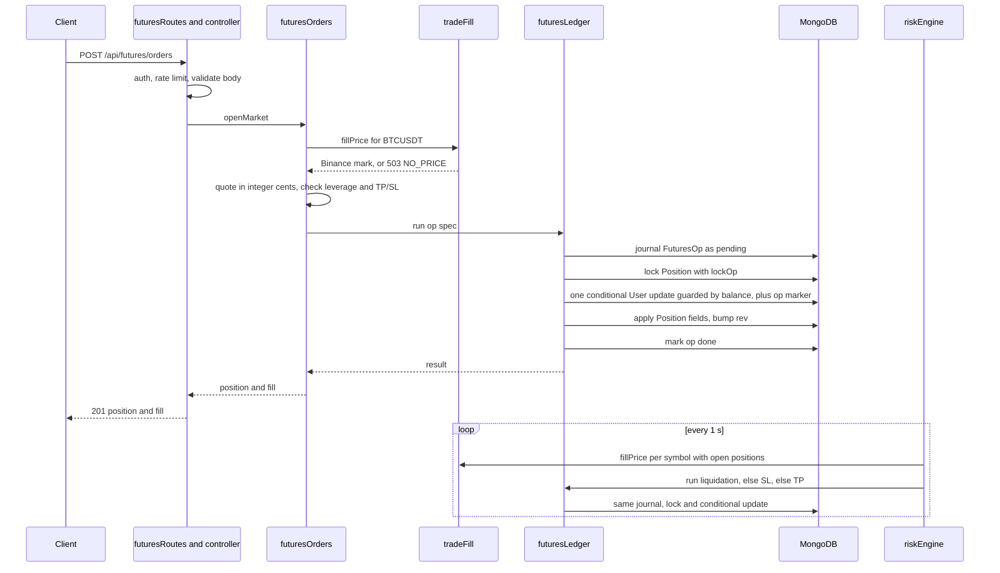
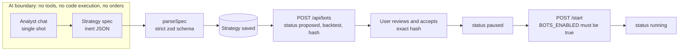
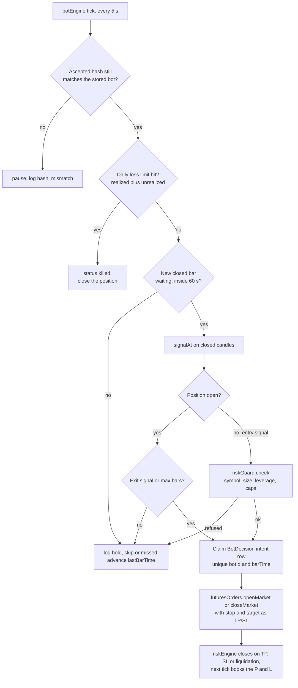
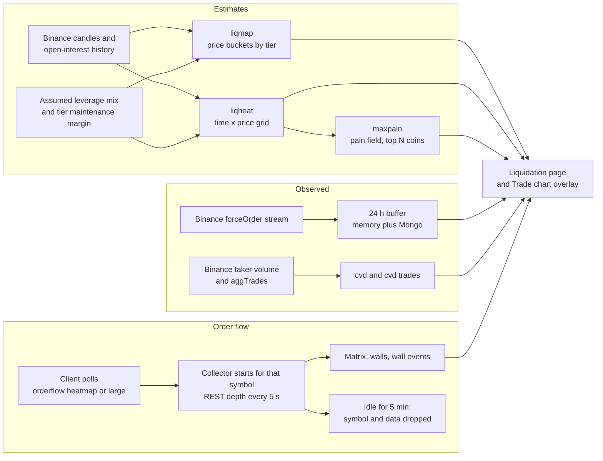

# Paperline

Paperline is a crypto **paper-trading and derivatives-analytics platform**. It reads real Binance USDS-M futures data (prices, order book, trades, funding, open interest, liquidations), turns it into liquidation maps, heatmaps and order-flow views, and lets you practise with **fake money**: spot and leveraged futures paper trading with TP/SL and a liquidation engine, alerts, backtested strategies, and paper-trading bots. An AI copilot explains the data and can propose strategies, but it never runs code and never places an order.

Live demo (the Render free tier sleeps when idle, so the first API call after a quiet period can take a minute):

- Frontend: <https://trade-mvp.vercel.app>
- API: <https://cryptozen-api.onrender.com> (`/api/health` is the health check)

### What this is, and what it is not

- It is a learning and analytics tool. Every balance is a paper balance (new users start with $100,000). Market data is real; fills are simulated by the server at its own Binance mark price.
- It does **not** move real money, connect to an exchange account, or take deposits.
- Liquidation maps, heatmaps, max pain and touch chances are **model estimates**, not exchange data. The liquidation feed is sampled. Backtests are hypothetical and in-sample.
- Nothing here is financial advice. The AI describes scenarios, not certainties.
- Real markets (NSE stocks, indices, gold, crude oil, FX) come from Yahoo Finance, which is unofficial and delayed. They are view-only; you cannot trade them.

AI agents and new engineers: start at [`context/README.md`](context/README.md) (architecture, money rules, conventions, gotchas). This file is the human-facing overview and the deploy guide.

## Contents

1. [Features](#features)
2. [Screenshots](#screenshots)
3. [Tech stack](#tech-stack)
4. [Architecture](#architecture)
5. [Project structure](#project-structure)
6. [How it works](#how-it-works)
7. [Quick start](#quick-start)
8. [Environment variables](#environment-variables)
9. [AI provider setup](#ai-provider-setup)
10. [Google OAuth setup](#google-oauth-setup)
11. [API overview](#api-overview)
12. [Data model](#data-model)
13. [Security notes](#security-notes)
14. [Testing](#testing)
15. [Deployment](#deployment)
16. [Pre-launch checklist](#pre-launch-checklist)
17. [Known limitations and roadmap](#known-limitations-and-roadmap)
18. [Contributing and license](#contributing-and-license)

There are no status badges: the repo has no CI workflow that runs the tests (only a keepalive ping), so a build badge would not be true. Current test counts are in [Testing](#testing).

## Features

**Paper trading**
- **Spot**: market and limit orders, holdings with average cost, 0.1% fee, $5 minimum. Limit orders reserve funds and are filled by a background matcher.
- **Leveraged futures**: USDT-margined linear perpetuals, isolated margin, long and short, 1x to 50x (capped per symbol and per position-size tier), market and limit entries, add to a position, partial or full close, change leverage on an open position, editable **TP/SL**, automatic **liquidation** by a server-side risk engine, 0.05% taker fee. Funding is not charged.
- **Alerts**: rules on mark price, funding rate or USD liquidated in 5 minutes, evaluated every 5 s on the server and pushed to the browser (toast, optional sound).
- Portfolio page: balance, holdings, futures margin, unrealised P&L, equity, trade history.

**Markets and derivatives analytics**
- **Trade page**: live candles, order book, trade tape, order card, positions. An optional **liquidation heatmap overlay** and liquidation levels can be drawn on the chart.
- **Derivatives page**: top-40 perpetuals table, funding strip, per-symbol open interest, long/short ratio, taker flow and funding charts, simple signal readouts.
- **Liquidation page**: real-time liquidation feed and coin treemap; a **liquidation heatmap** (time x price) and a **liquidation map** (price buckets split by leverage tier), both estimated from open-interest changes and an assumed leverage mix; a **max pain "pain field"** across the top coins; an **order book heatmap** with wall tracking; **large orders** (walls and large trades); **cumulative volume delta (CVD)** for futures and spot. Charts support zoom and pan.
- **Markets page**: top-20 coins by market cap from CoinGecko, live over Socket.IO.
- **Real markets** (`/stocks` and the Derivatives "Real markets" panel): curated NSE stocks, NIFTY 50 / BANK NIFTY / NIFTY IT, gold, silver, WTI, Brent, USD/INR, EUR/INR, GBP/INR, EUR/USD. View only, unofficial Yahoo data.
- **News**: headlines from RSS feeds (3 crypto, 3 Indian markets) with in-app detail pages (`/news`, `/news/:id`) that link out to the publisher. Headline, short snippet and a hotlinked image only; no full text.
- **Dashboard**: tiles (price, portfolio, open interest, funding, liquidations, alerts, sentiment), movers with a rule-based trade-bias readout, recent liquidations, holdings, alert triggers, news.
- **Resilient data sources**: if Binance futures REST is blocked, analytics fall back to Bybit, Bitget, Gate or MEXC (labelled in the UI and in `X-Data-Source`). Third-party prices never feed fills, marks, liquidations, TP/SL or alerts.

**AI copilot**
- Per-symbol market **brief** (structured: headline, bias, confidence, drivers, risks, levels; cached 5 min), free-form **Ask**, and natural-language **alert drafting** that is validated before you can save it.
- **Analyst dock**: single-shot chat about the chart you are on (crypto perp or a curated market) with source-tagged data. Answers can be **structured** (verdict, plan, levels, bull/bear cases, risks). Prompt templates are built in.
- **Strategy proposals**: the AI may return a strategy only as a strict declarative JSON spec (a fixed DSL of indicators, conditions and risk settings). The server validates it, backtests it with fees and slippage and no look-ahead, and overlays it on the chart. **The AI never runs code and never places orders.**
- Model choice: Opus 5.5, Sonnet 5.5 or Haiku 5.5 on the server key, or bring your own key (Anthropic, OpenAI, Gemini, OpenRouter, custom https endpoint) with a model picker that lists the provider's models, or a local LM Studio model when you run the backend yourself. Style prompt, answer length and an opt-in to share your paper portfolio.

**Strategies and bots**
- **Strategy engine**: up to 20 saved strategies per user, backtests on server-fetched candles (signal on bar i fills at the open of bar i+1, stop before target within a candle, 0.05% fee per side and 0.02% slippage by default), applied to the chart on its timeframe.
- **Paper-trading bots** (`/bots`): a bot is one accepted strategy spec on one symbol and interval. You must **accept the exact spec by hash** before it can start. Risk guard on every entry, a **daily-loss kill switch**, an idempotent, crash-safe engine (one decision per closed bar), a full decision log, and **performance versus buy-and-hold** with honest sample-size labels ("Too few trades to mean anything" under 30 trades, "Weak evidence" under 100). Bots are capped (5 per user, 3 running, leverage 1x to 5x) and are **off in production unless `BOTS_ENABLED=true`**.

**Accounts and settings**
- Email/password and **Google sign-in**, 24 h JWT sessions, sign out everywhere, profile, preferences (ticker bar, compact tables, reduced motion, time format, landing page, alert sound), data export and account deletion. A public `/docs` page in the app explains the features.

## Screenshots

There are no screenshot files in the repo yet. TODO: capture these pages and add them under `docs/screenshots/`, then link them here.

- [ ] Trade page (chart with heatmap overlay, book, tape, order card, positions)
- [ ] Liquidation page (heatmap, liquidation map, pain field, order book heatmap, CVD)
- [ ] Derivatives page
- [ ] Dashboard
- [ ] AI analyst dock with a structured answer and a strategy card
- [ ] Bots page (decision feed and performance panel)
- [ ] Alerts panel

## Tech stack

| Layer | Choice |
|---|---|
| Backend | Node.js (CommonJS), Express 4, Socket.IO 4, Mongoose 8 (MongoDB), `ws` (Binance streams), axios, Joi (env validation), express-validator, helmet, cors, morgan, winston, bcryptjs, jsonwebtoken, google-auth-library, `@anthropic-ai/sdk` and zod (AI structured output and the strategy DSL) |
| Frontend | React 18 (Create React App, react-scripts 5), react-router-dom 7, zustand, Tailwind CSS 3, lightweight-charts (candles), canvas (heatmaps), socket.io-client, axios |
| Data | MongoDB (local or Atlas); in-memory buffers and caches for live market data |
| External | Binance USDS-M futures and spot mirror (REST and WebSocket, no key), Bybit / Bitget / Gate / MEXC public REST (fallback analytics), CoinGecko, Yahoo Finance, RSS feeds, Anthropic API and other AI providers (optional), Google Identity Services (optional) |
| Tests | Jest on both sides; the backend uses in-memory fakes of the Mongoose models, the frontend uses `react-dom/test-utils` (no React Testing Library) |

## Architecture

The backend is **one long-running Node process**: the HTTP API, Socket.IO and every background engine live together. That is a deliberate design choice (see [How it works](#how-it-works)) and it is why the backend cannot run on a serverless platform.

### 1. System context



The SPA talks to the API over REST (JWT in the `Authorization` header) and to three Socket.IO namespaces. The engines read prices from `futuresService` (Binance WebSocket marks, with a Binance REST fallback) and write to MongoDB through the money paths only. Everything that is not Binance is analytics or content, never a price that moves paper money.

### 2. Market-data gateway



Each provider has its own circuit breaker (418, 403, 451 and 429 open it for at least a few minutes, with a single probe allowed when it is due). The registry knows which symbols each provider lists, so an unlisted symbol costs no request. Answers carry a source tag that becomes `X-Data-Source` (`binance-futures`, `ws`, `bybit`, `bitget`, `gate`, `mexc`, `spot`, `yahoo`, `unavailable`) and the UI says so when the data is not Binance futures. The bottom box is the hard rule: `fillPrice` uses only Binance prices, so the gateway module is never on a money path.

### 3. Paper futures order



The client never sends a price. The ledger journals the operation first, locks the position, changes the balance with one conditional update and records a per-operation marker, so a crash at any step is rolled forward by recovery without charging twice. The risk engine uses the same ledger, so a user close racing a stop-out settles exactly once (the loser gets `POSITION_BUSY`).

### 4. Bot lifecycle and the AI boundary

The setup path. The only thing the AI can produce is inert data, and a human acceptance by hash gates everything after it.



The tick path. Every 5 seconds the engine walks the running bots; orders go only through `futuresOrders`.



The unique `{botId, barTime}` index on `BotDecision` is the claim: the engine inserts the decision row before it orders, so a crash or a restart can cost at most one entry and can never place a second one for the same bar. A restart finds old `intent` rows and settles them (`recoverIntents`). The engine file imports no AI, news or ledger code (a test checks the require list). If the host sleeps, bars are missed and logged as `missed`; a closed bar may be decided up to 60 s after its close.

### 5. Liquidation page data flow



The map and heatmap are models: open-interest increases are spread over an assumed leverage mix and turned into liquidation prices, so they are estimates by construction. The real liquidation feed is what Binance streams (sampled). The order-book collector samples REST depth itself, only for symbols someone is looking at (up to 5 at once), so the heatmap only holds the depth seen since collection started; when the exchange changes (Binance blocked, fallback used) the matrix is cleared rather than mixing venues.

### Where to look in the code

| Concern | Path |
|---|---|
| Wiring, engines start/stop, Socket.IO namespaces | `backend/server.js` |
| Env validation | `backend/config/config.js` |
| Auth, JWT, account checks | `backend/controllers/authController.js`, `backend/middleware/auth.js` |
| Spot orders and matcher | `backend/controllers/tradeController.js`, `backend/services/orderMatcher.js`, `backend/services/tradeFill.js` |
| Futures API, order logic | `backend/controllers/futuresController.js`, `backend/services/futuresOrders.js` |
| Exactly-once money executor | `backend/services/futuresLedger.js` |
| Money math (integer cents) | `backend/services/tradeMath.js`, `backend/services/futuresMath.js` |
| Liquidation, TP/SL, limit fills | `backend/services/riskEngine.js` |
| Binance streams, marks, liquidation buffer | `backend/services/futuresService.js` |
| Market-data gateway | `backend/services/marketData/` (`index.js`, `breaker.js`, `registry.js`, `validate.js`, `providers/`) |
| Liquidation estimate models | `backend/services/futuresUtils.js`, `backend/services/maxPain.js`, `backend/services/cvd.js` |
| Order-book collector | `backend/services/orderflow/` |
| Real markets allow-list | `backend/services/marketData/instruments.js`, `providers/yahoo.js` |
| News | `backend/services/news.js` |
| AI | `backend/services/aiService.js`, `aiProviders.js`, `secretBox.js`, `backend/services/ai/` |
| Strategy DSL and backtests | `backend/services/strategy/` |
| Bots | `backend/services/bot/` (`botEngine.js`, `riskGuard.js`, `performance.js`), `backend/routes/botRoutes.js` |
| Bot research scripts | `backend/scripts/botlab/` |
| Alerts | `backend/services/alertService.js`, `backend/routes/alertRoutes.js` |
| Frontend pages and routing | `frontend/src/App.js`, `frontend/src/pages/` |
| Frontend API base and sockets | `frontend/src/lib/api.js`, `apiBase.js`, `socket.js` |

## Project structure

```
trade_mvp/
├── backend/                     Express + Socket.IO + Mongoose, engines in the same process
│   ├── server.js                wiring and engine start/stop
│   ├── config/                  config.js (Joi env), logger.js (winston)
│   ├── controllers/             auth, trade, order, futures, BaseController
│   ├── middleware/              auth, rateLimit, validator, errorHandler
│   ├── models/                  User, Trade, Order, Position, FuturesOrder, FuturesOp, Alert, AlertEvent,
│   │                            Liquidation, Strategy, AiConversation, Bot, BotDecision
│   ├── routes/                  auth, trade, order, futures, market, orderflow, news, ai, agent, strategy,
│   │                            bot, alert, health
│   ├── services/
│   │   ├── ai/                  analyst chat, context builder, access, plan
│   │   ├── bot/                 botEngine, riskGuard, performance
│   │   ├── marketData/          gateway, breaker, registry, validate, providers/ (binance, bybit, bitget, gate, mexc, yahoo)
│   │   ├── orderflow/           collector, walls, bookStats, providers
│   │   ├── strategy/            schema, indicators, evaluate, backtest, describe, hash
│   │   └── *.js                 futuresLedger, futuresOrders, riskEngine, orderMatcher, tradeFill, futuresService, ...
│   ├── scripts/botlab/          offline bot capability study (fetch, study, analyze, goal)
│   ├── tests/                   Jest, in-memory fakes
│   └── .env.example
├── frontend/                    Create React App (React 18, zustand, Tailwind)
│   ├── public/
│   ├── vercel.json              SPA rewrite and security headers
│   └── src/
│       ├── pages/               Home, Dashboard, Trade, Derivatives, Liquidation, Portfolio, Bots, Market, Stocks,
│       │                        News, NewsItem, Docs, Settings (+ settings/), Login, register
│       ├── components/          ai, alerts, auth, bots, dashboard, derivatives, home, liquidation, market, news,
│       │                        shell, trade, ui (company/ is legacy and unused)
│       ├── lib/                 api, sockets, hooks, pure helpers (futuresMath, moverBias, ...)
│       └── store/               zustand stores
├── context/                     engineering docs: ARCHITECTURE, DOMAIN, DECISIONS, GOTCHAS, TODO, bot study
├── docs/phase2-leverage.md      original futures design spec (code wins where they differ)
├── .github/workflows/keepalive.yml
├── CLAUDE.md, AGENTS.md         rules and commands for AI coding agents
└── README.md
```

## How it works

**Money rules.** Both trading engines compute in **integer cents** and store dollars as `cents / 100`. Rounding always favours the house: fees and margin round up, P&L rounds down, so the house never loses a cent. Every balance change is **one conditional update** (for example "debit only if `balance >= debit`"); there is no read-modify-write of a balance. Fills happen only at the server price (`tradeFill.fillPrice`); the client never sends one. Futures money moves only through `futuresLedger`. Full rules: [`context/DOMAIN.md`](context/DOMAIN.md).

**Spot and futures are separate engines** that share only `User.balance`. Spot settles with one conditional `$inc` of balance and holdings together. Futures uses a write-ahead journal (`FuturesOp`) with roll-forward recovery and a per-operation marker on the user, instead of Mongo transactions, so it works on a standalone mongod or an Atlas free tier and every step is idempotent.

**Data layer.** MongoDB holds durable state (accounts, trades, orders, positions, the futures journal, alerts, strategies, bots, conversations). Live market data is in memory: Binance marks and the liquidation buffer in `futuresService`, caches in `futuresRest` and the gateway, the order-book matrix in the collector. TTL indexes expire alert events (30 days), liquidations (2 days), AI conversations (30 days) and bot decision rows (hold rows 14 days, others 1 year).

**Single process.** API, sockets and engines run together because they share in-memory marks, buffers, limiters and engine state. Two live engines would race on ledger recovery, so there is exactly one instance and deploys are stop-then-start.

**Design decisions.** Why it is built this way (single process, journal ledger, estimates labelled as estimates, AI never executes code, provider fallbacks, bots with accept-hash approval and more) is logged with dates in [`context/DECISIONS.md`](context/DECISIONS.md). Surprises and traps are in [`context/GOTCHAS.md`](context/GOTCHAS.md); open work is in [`context/TODO.md`](context/TODO.md).

## Quick start

### Prerequisites

- Node.js 18+ (20 LTS recommended) and npm
- MongoDB 6+ running locally (`mongodb://127.0.0.1:27017`) or a MongoDB Atlas URI
- Outbound access to `fapi.binance.com` and `fstream.binance.com` (some regions, including the US, are blocked by Binance with HTTP 451; analytics then fall back to other exchanges, but paper fills need a Binance price) and `api.coingecko.com`

There is no root `package.json` and no single "run everything" command: run the backend and the frontend in two terminals.

### 1. MongoDB

```bash
# option A: Docker
docker run -d --name trade-mongo -p 27017:27017 mongo:7
# option B: Homebrew
brew services start mongodb-community
```

### 2. Backend

```bash
cd backend
npm install
cp .env.example .env
# edit .env: set JWT_SECRET (>= 32 chars), e.g.
node -e "console.log(require('crypto').randomBytes(48).toString('base64url'))"
npm start            # node server.js, listens on 127.0.0.1:4000
```

`.env.example` already sets `NODE_ENV=development` and `MONGO_URI=mongodb://127.0.0.1:27017/crypto_trading_mvp`. `backend/.env` is git-ignored. The server refuses to start if `NODE_ENV`, `MONGO_URI` or a real `JWT_SECRET` is missing.

### 3. Frontend

```bash
cd frontend
npm install
npm start                      # http://localhost:3000
```

`frontend/.env.development` already sets `REACT_APP_API_URL=http://localhost:4000`; copy `frontend/.env.example` to `.env.local` only to override it.

### 4. Demo user

Either register in the UI (`/register`), or seed a demo guest. In `backend/.env`:

```
NODE_ENV=development
SEED_DEMO_USERS=true
DEMO_GUEST_PASSWORD=choose-a-12plus-char-password
```

Restart the backend. It creates (or resets) `guest@cryptozen.com` with that password, role `user`. In development, on loopback only, `/login` shows a "test login" card filled from `GET /api/auth/dev-hint`. Seeding never creates an admin.

Bots are on by default in development. AI features need `ANTHROPIC_API_KEY` or a signed-in Claude Code CLI (development only); see [AI provider setup](#ai-provider-setup).

### 5. Tests

```bash
cd backend  && npm test                                     # jest
cd frontend && CI=true npm test -- --watchAll=false         # react-scripts test
```

If npm complains about its cache directory in a sandbox, add `--cache "$TMPDIR/npm-cache"` to `npm install`/`npm ci`.

## Environment variables

### Backend (`backend/.env`, loaded by `dotenv`; template: `backend/.env.example`)

| Variable | Required | Default | Purpose |
|---|---|---|---|
| `NODE_ENV` | yes | none | `development` / `production` / `test`. Gates dev-only features (CLI AI provider, `dev-hint`), the `HOST` default and production config checks (below). |
| `MONGO_URI` | yes | none | MongoDB connection string. |
| `JWT_SECRET` | yes | none | HS256 signing key, >= 32 chars (enforced in every environment); values that look like placeholders (`changeme`, `secret...`, `example`, `xxxxxx`...) are rejected at startup. |
| `ENCRYPTION_KEY` | no | derived from `JWT_SECRET` | Key for saved BYO AI keys (AES-256-GCM): 64 hex chars or base64 of 32 bytes. Invalid value fails startup (the value is never printed). Unset: HKDF from `JWT_SECRET` with one startup warning. Rotating it (or `JWT_SECRET` when unset) makes saved AI keys unreadable: `ai_key_unreadable` 409, the user re-enters the key. |
| `PORT` | no | `4000` | HTTP port. Hosts that inject `PORT` just work. Do not leave it set but empty. |
| `HOST` | no | `127.0.0.1` (`0.0.0.0` when `NODE_ENV=production`) | Bind address. Set only to override the default. |
| `TRUST_PROXY` | no | `0` | Reverse-proxy hops to trust for `req.ip` (rate-limit keys): `0`/`false`, a hop count (`1` on Render/Railway/Fly), or `true` (trusts every `X-Forwarded-For` entry, spoofable). Applied with `app.set('trust proxy', ...)` before any limiter. Invalid values fail startup. |
| `LOG_TO_FILES` | no | `true` outside production, `false` in production | `true`/`false`: also write `error.log`/`combined.log` in the cwd. Console logging is always on (JSON in production, text in development). |
| `CORS_ORIGINS` | no | `http://localhost:3000,http://localhost:3001` | Comma-separated exact browser origins for REST CORS **and** Socket.IO (no trailing slash, no wildcard). Do not leave set but empty. **Required in production** (no default; a wildcard or empty list fails startup). |
| `SEED_DEMO_USERS` | no | off | `true` seeds/refreshes `guest@cryptozen.com` (role user) on boot. **Refused in production**: `NODE_ENV=production` + `true` fails startup. |
| `DEMO_GUEST_PASSWORD` | with seeding | none | Guest password, >= 12 chars, else seeding is skipped with a warning. Also used by `dev-hint` (development only). |
| `GOOGLE_CLIENT_ID` | no | none | Google OAuth Web client ID (public). Empty disables the Google button. |
| `ANTHROPIC_API_KEY` | no | none | Enables the AI copilot via the Anthropic API. If neither this nor `ANTHROPIC_AUTH_TOKEN` is set in production, the server logs a warning and AI is disabled (the CLI provider never runs in production). |
| `ANTHROPIC_AUTH_TOKEN` | no | none | Alternative Anthropic credential (also enables AI). |
| `AI_MODEL` | no | `claude-opus-5-5` | Server default model; users may pick another from the allow-list in Settings. |
| `AI_MAX_CALLS_PER_HOUR` | no | `60` | Process-wide ceiling on billed AI calls per rolling hour (`0` blocks all). |
| `LMSTUDIO_BASE_URL` | no | `http://localhost:1234/v1` | Default LM Studio base URL when a user leaves it empty. Must be `localhost`, `127.0.0.1` or `[::1]`. |
| `LMSTUDIO_MODEL` | no | `qwen/qwen3.5-9b` | Default LM Studio model id when a user leaves it empty. |
| `LMSTUDIO_MAX_TOKENS` | no | `4096` | `max_tokens` for LM Studio calls (never below 1500): reasoning models spend tokens thinking before the answer. |
| `LMSTUDIO_REASONING_EFFORT` | no | `none` | `reasoning_effort` sent to LM Studio. `none` turns Qwen 3.5 thinking off (a thinking brief took minutes on a laptop); `low`/`medium`/`high` turn it on. |
| `ALLOW_LOCAL_LLM` | no | off | `true` allows LM Studio (loopback URLs) when `NODE_ENV=production`. Off by default: on a shared server a user-controlled loopback URL is SSRF. |
| `AI_PROVIDER` | no | unset | Code-only (not in `.env.example`). `api` forces the Anthropic API even in development, disabling the CLI provider. |
| `CLAUDE_BIN` | no | `claude` | Code-only. Path of the Claude Code CLI used by the dev-only CLI provider. |
| `BINANCE_FUTURES_REST` | no | `https://fapi.binance.com` | REST base URL (e.g. a proxy). |
| `BINANCE_SPOT_REST` | no | `https://data-api.binance.vision` | Spot mirror, the last kline fallback when every futures source fails (spot prices, so candles differ slightly). |
| `BYBIT_REST` | no | `https://api.bybit.com` | Bybit v5 public REST (no key), second in the market-data chains (used when Binance futures REST fails): perpetual candles, open interest, long/short ratio, funding, liquidation map/heatmap inputs, overview open interest. Numbers are Bybit's and differ from Binance. |
| `BITGET_REST` | no | `https://api.bitget.com/api/v2/mix/market` | Bitget USDT-M public REST (no key), after Bybit: candles, long/short ratio, funding. Analytics only. |
| `GATE_REST` | no | `https://api.gateio.ws/api/v4/futures/usdt` | Gate USDT futures public REST (no key), after Bitget: candles, open interest, ratios, taker volume, funding. Analytics only. |
| `MEXC_REST` | no | `https://contract.mexc.com/api/v1/contract` | MEXC futures public REST (no key), last exchange in the chain: candles and funding. Analytics only. |
| `YAHOO_REST` | no | `https://query1.finance.yahoo.com` | Yahoo Finance (unofficial, delayed, view only) for the curated stocks, indices, commodities and currencies. Never used for trading. |
| `BINANCE_FUTURES_WS` | no | `wss://fstream.binance.com` | WebSocket base URL. |
| `MARKET_POLL_INTERVAL_MS` | no | `30000` | CoinGecko poll interval for the Markets page. |
| `BOTS_ENABLED` | no | on in development and test, **off in production** | Paper-trading bots. Exactly `true` or `false` overrides the default. When off, `POST /api/bots/:id/start` answers 403 `BOTS_DISABLED` and the bot engine runs nothing (open bot positions are still closed). Turn it on only on an always-on instance: a sleeping server misses bars. |

### Frontend (Create React App; values are inlined at **build time**)

| Variable | Default | Purpose |
|---|---|---|
| `REACT_APP_API_URL` | empty | Base URL of the backend, used for every REST call **and** Socket.IO (no trailing slash; trailing slashes are stripped once in `frontend/src/lib/apiBase.js`, which every call site imports). If empty, REST uses same-origin paths and sockets fall back to `<page origin with port replaced by :4000>`, which is wrong on any hosted domain. Files: `frontend/.env.development` (localhost:4000), `frontend/.env.production` (placeholder), `frontend/.env.example`. |

The Google client ID is **not** a frontend variable; the SPA reads it from `GET /api/auth/config`.

## Using Trade from Orrery

Trade can be registered as an app in Orrery (the owner's chat workspace). Orrery gets **public market data only**, read-only: no portfolio, trades, futures orders, bots, AI endpoints or any other user data. It is off until `ORRERY_APP_SECRET` is set.

What it exposes:
- `GET /.well-known/orrery-app.json`: manifest (`auth: "orrery-jwt"`, `permission: "read"`, capabilities `ohlc`, `timeseries`, `table`, `link`, deep links `home` -> `/` and `symbol` -> `/trade?symbol={symbol}`). 404 while unset.
- `POST /api/orrery/mcp`: minimal MCP streamable-HTTP endpoint (JSON-RPC, stateless, no sessions; GET is 405). Tools, all `readOnlyHint: true`: `klines`, `market_stats`, `liquidation_map` (an estimate), `cvd`, `instruments`, `news`. They call the same services as `/api/market/*` and `/api/news` (same symbol/interval whitelists, candles capped at 1000). Auth is an HS256 Bearer token checked with Node `crypto` (`iss`, `aud`, `exp`/`iat` with 30 s skew, `alg` pinned). Limits: 60 calls/min per token subject (the user's email), plus 600/min per IP as a backstop. Each call logs one JSON line with the subject.
- `POST /api/orrery/sso` and SPA route `/sso?token=&next=`: Orrery sends the user with a 60 s single-use token (`purpose: "sso"`); the SPA trades it for a normal Trade session **only if an account with that email already exists** (nothing is auto-created; otherwise the login page opens with the email prefilled). `next` must be a same-origin relative path.
- With `REACT_APP_ORRERY_URL` set, the SPA shows a thin "Part of Orrery" strip.

| Variable | Where | Default | Purpose |
|---|---|---|---|
| `ORRERY_APP_SECRET` | backend (Render) | unset = integration off | Shared HS256 secret shown once by Orrery at registration. Never commit it. |
| `ORRERY_APP_ID` | backend | `trade` | Expected `aud`, and the manifest `id`. |
| `ORRERY_ISSUER` | backend | `orrery` | Expected `iss`. |
| `ORRERY_BASE_URL` | backend | `https://trade-mvp.vercel.app` | Public origin written into the manifest (must be the origin you register). |
| `REACT_APP_ORRERY_URL` | frontend (Vercel, build time) | unset = strip hidden | Link target of the strip. |

Registration steps:
1. Deploy this branch. `frontend/vercel.json` rewrites `/.well-known/orrery-app.json` and `/api/orrery/*` from the Vercel origin to the Render API, so the manifest, MCP URL, icon and SSO path all share one origin (Orrery requires that).
2. In Orrery (owner): register `https://trade-mvp.vercel.app/.well-known/orrery-app.json` with preview, check the six tools, approve. Copy the generated secret.
3. Set `ORRERY_APP_SECRET` (and `ORRERY_ISSUER=orrery`) on Render and restart the backend. Optionally set `REACT_APP_ORRERY_URL` on Vercel and redeploy.
4. Check: `curl https://trade-mvp.vercel.app/.well-known/orrery-app.json` returns the manifest, and `curl -X POST https://trade-mvp.vercel.app/api/orrery/mcp` returns 401 (not 404/503). The keepalive workflow also pings the manifest path.

Note the order: Orrery shows the secret only after registration, but registration fetches the manifest, which is 404 until a secret exists. Set a temporary `ORRERY_APP_SECRET` first, register, then replace it with the real one.

## AI provider setup

The AI features (`/api/ai/*`) work with one of two providers, chosen at request time by `aiService.provider()`:

1. **Anthropic API (production path).** Set `ANTHROPIC_API_KEY` (or `ANTHROPIC_AUTH_TOKEN`) in `backend/.env` and restart. Requests use structured outputs (zod), `claude-opus-5-5` by default (`AI_MODEL` to change), prompt-cached system prompts, `output_config.effort`. Check with `GET /api/ai/status` -> `{configured, model, provider: "api"}`.
2. **Claude Code CLI (development only).** When `NODE_ENV=development`, no `ANTHROPIC_*` credential is set, `AI_PROVIDER` is not `api`, and `claude auth status` reports a login, the server spawns `claude -p` (no shell, prompt on stdin, tools disabled, `ANTHROPIC_*` stripped from the child env, 120 s timeout, 2 concurrent) on the signed-in claude.ai account. `provider` reports `"cli"`. This is a convenience for local work and **never activates when `NODE_ENV` is anything other than `development`**.

Without either, AI endpoints answer `503 ai_not_configured` and the UI shows a setup hint.

**Bring your own key.** In Settings -> AI a user can pick `anthropic`, `openai`, `gemini`, `openrouter`, `custom` (any https endpoint) or `lmstudio` (local, below) instead of `default` (the server path above). Keys are encrypted at rest (AES-256-GCM, see `ENCRYPTION_KEY`), never returned (only `keySet` and the last 4 chars), and dropped from the data export. Calls go out over plain `https.request` with no redirects. A custom base URL must be https (http allowed only when `NODE_ENV=development`) and may not point at localhost, `.internal`, private, loopback, CGNAT, link-local/metadata, multicast or mapped IPv6 ranges; hostnames are checked at connect time (DNS-rebinding safe). Temperature is never sent to Anthropic, nor to OpenAI `gpt-5*`/`o*` models. Your style prompt (<= 2000 chars) goes before the server rules; the rules (data only, scenarios not certainty, "sampled"/"estimate" wording, both cases, word cap 100/180/300) and the not-financial-advice disclaimer are always appended and enforced in code. Optional "include my portfolio" adds your paper cash, holdings and open futures positions to the context.

**LM Studio (local models).** Pick `LM Studio (local)` in Settings -> AI. No key is needed (the field is hidden; a placeholder bearer is sent). Base URL defaults to `http://localhost:1234/v1` (`LMSTUDIO_BASE_URL`), model to `qwen/qwen3.5-9b` (`LMSTUDIO_MODEL`); "Fetch models" lists the chat models LM Studio has loaded (`GET /api/ai/lmstudio/models`, embedding models filtered out). The base URL may only be `localhost`, `127.0.0.1` or `[::1]` by literal text (http or https, optional port and path): userinfo, decimal/hex/mapped IP forms, other DNS names, private ranges and metadata IPs are refused, `localhost` must resolve to loopback at connect time, and redirects are not followed. It works when `NODE_ENV` is not `production`, or with `ALLOW_LOCAL_LLM=true`. Calls use a 180 s timeout, thinking off by default (`LMSTUDIO_REASONING_EFFORT`), a trimmed market-data block (the default loaded context is only 8192 tokens; overflow answers `502 ai_context_too_small`), and `max_tokens` of at least 1500 (`LMSTUDIO_MAX_TOKENS`, default 4096) because reasoning models (Qwen 3.5) think first; the Length setting still trims the visible answer. Thinking (`reasoning_content`, `<think>` blocks) is never shown; if the model spends the whole budget thinking, the API answers `502 ai_reasoning_budget`. LM Studio may forward to a model on another machine; this server only ever talks to loopback. The "include my portfolio" consent applies exactly as for other providers.

Cost and abuse controls: 10 AI requests per user per minute, a process-wide hourly budget (`AI_MAX_CALLS_PER_HOUR`), a 5-minute brief cache per symbol+model (concurrent callers share one in-flight call), failures are never cached.

## Google OAuth setup

The app uses Google Identity Services (ID-token flow): the browser gets a Google ID token, posts it to `POST /api/auth/google`, the backend verifies it against `GOOGLE_CLIENT_ID`, requires `email_verified`, and issues its own JWT.

1. Google Cloud Console -> APIs & Services -> OAuth consent screen: configure the app (External, add test users while in Testing).
2. Credentials -> Create credentials -> **OAuth client ID** -> type **Web application**.
3. **Authorized JavaScript origins**: `http://localhost:3000` and your production frontend origin (for example `https://your-app.vercel.app`, plus any custom domain). No redirect URI is needed for this flow.
4. Copy the client ID into `GOOGLE_CLIENT_ID` in the **backend** environment (it is public, not a secret) and restart the backend. The frontend fetches it from `/api/auth/config`.
5. Accounts: a first Google sign-in links an existing account with the same verified email, or creates a user with a random unusable password. Locked accounts and accounts already linked to a different Google `sub` are refused.

## API overview

Base URL `http://localhost:4000` (live: `https://cryptozen-api.onrender.com`). "Auth" means `Authorization: Bearer <jwt>`. The full route reference (every route, limits, error codes, request and response shapes) is in [`docs/api.md`](docs/api.md). Every router below is mounted in `backend/server.js`.

| Prefix | Auth | What it covers |
|---|---|---|
| `/api/health` | no | `GET /` liveness: `{ok, uptime, mongo}`, 200 even if Mongo is down |
| `/api/auth` | mixed | register, login, Google sign-in, `config`, verify, `me` (get, patch, avatar, export, delete), password, logout-all, dev-only `dev-hint` |
| `/api/trades`, `/api/orders` | yes | spot orders, portfolio, open limit orders and cancel |
| `/api/futures` | yes | `config`, positions, orders, place order, close, edit TP/SL and leverage, cancel |
| `/api/market` | no (120/min per IP) | CoinGecko proxies; `futures/` overview, symbols, klines, stats, `liqmap`, `liqheat`, `maxpain`, `cvd` (and `cvd/:symbol/trades`), `liquidations`; `stocks/` and `instruments/` (Yahoo); `orderflow/heatmap` and `orderflow/large`; `providers` health |
| `/api/news` | no (60/min per IP) | headline list and one headline by id |
| `/api/ai` | yes | `status`, `brief`, `ask`, `alerts/parse`, BYO keys (`keys/:provider`), `test`, `models`, `lmstudio/models`, and the analyst under `agent/` (`chat`, `conversations`) |
| `/api/strategies` | yes | validate, evaluate (backtest), CRUD |
| `/api/bots` | yes | config, CRUD, accept, decline, start, pause, stop, stop-all, decisions, performance |
| `/api/alerts` | yes | CRUD and recent events |

Conventions: errors use `{success:false, message}` (futures adds `code`; alerts, AI, market and bots use `{error}`). Symbols in `/api/market/*`, `/api/ai/*` and alerts are full futures symbols (`BTCUSDT`); trading routes use the base ticker (`BTC`). Every market response carries `X-Data-Source`.

Socket.IO namespaces: `/market` (public, `market:update`), `/futures` (public, subscribe per symbol: kline, mark, book, trades, liquidation), `/alerts` (JWT in the handshake, `alert:triggered`).

## Data model

| Collection (model) | Purpose | Key fields |
|---|---|---|
| `User` | Account, paper cash, spot holdings | `username`, `email`, `password` (bcrypt), `googleId?`, `role`, `balance` (USD, default 100000), `holdings` (Map base -> amount), `futuresOps` (idempotency markers), `preferences`, `profile`, `ai.model`, `lockedAt?`, `passwordChangedAt?` |
| `Trade` | Spot fill history | `userId`, `cryptoSymbol`, `type`, `amount`, `priceAtTrade`, `fee`, `orderId?` |
| `Order` | Spot limit orders | `symbol`, `side`, `amount`, `limitPrice`, `reserved`, `status` (open/filled/cancelled/rejected/error) |
| `Position` | Futures isolated position | `symbol`, `side`, `size`, `entryPrice`, `leverage`, `margin`, `mmr`, `liqPrice`, `tp`, `sl`, `status`, `activeKey` (unique sparse), `lockOp`, `rev`, `realizedPnl`, `fees` |
| `FuturesOrder` | Futures limit entry orders | `symbol`, `side`, `size`, `leverage`, `limitPrice`, `reserved`, `status` |
| `FuturesOp` | Write-ahead journal for futures money ops | `kind`, `targets`, `deltaCents`, `post`, `status` (pending/done/rolled_back/error), `attempts` |
| `Alert` / `AlertEvent` | Alert rules / trigger history (TTL 30 days) | `metric`, `op`, `value`, `cooldownMin`, `lastTriggeredAt` |
| `Liquidation` | Persisted realised liquidation events (TTL 2 days) | `symbol`, `side`, `price`, `qty`, `usd`, `ts` |
| `Strategy` | Saved declarative strategy spec | `userId`, `name`, `spec`, `specHash`, `symbol`, `origin` (ai/user), `allTimeframes` |
| `AiConversation` | Analyst chat history (TTL 30 days) | `userId`, `messages` (max 40), `updatedAt` |
| `Bot` | One accepted strategy spec on one symbol and interval, with limits | `spec`, `specHash`, `acceptedHash`, `status` (proposed/declined/paused/running/stopped/killed), `rev`, `lastBarTime`, `positionId`, `day` counters, `startMark` |
| `BotDecision` | Append-only decision log; unique `{botId, barTime}` is the per-bar claim | `kind` (tick/risk/observed/lifecycle), `action`, `status` (intent/done/failed/abandoned), `reason` (built in code), `fillPrice`, `pnlCents` |

Money units: spot and futures engines compute in **integer cents**; stored dollar fields are `cents / 100`. Details in [`context/DOMAIN.md`](context/DOMAIN.md); the original futures design is [`docs/phase2-leverage.md`](docs/phase2-leverage.md) (where code and doc differ, the code wins: for example `Position.rev` exists in code only).

## Security notes

What is in place:
- **JWT** HS256, 24 h, payload `{userId, role}`. The auth middleware pins `algorithms: ['HS256']` and re-reads the user on **every** request: a deleted user, a `lockedAt` account, or a token issued before `passwordChangedAt` is rejected (this is the revocation mechanism). Socket.IO `/alerts` applies the same check.
- Passwords: bcrypt (cost 10), 8..72 chars; login does one bcrypt compare even for unknown emails (no timing oracle); generic "Invalid email or password".
- `role` is never read from request bodies; admins are set in the database. Legacy public accounts (`admin@cryptozen.com`, and the guest unless seeding is on) are locked at boot.
- Input validation: express-validator with strict types and unknown-key rejection on `PATCH /me` and futures routes; `:id` params must be 24-hex; symbols are regex-checked before reaching any Mongo update path.
- `helmet`, `express.json({limit:'100kb'})`, CORS allow-list, Socket.IO `allowRequest` origin check, morgan logs no bodies/headers, winston redacts secrets and drops request/response objects.
- **Rate limits** (in-memory sliding window, see the API tables; IPv6 keyed per /64).
- Server-side prices only; users can only act on their own documents (other users' ids return 404).

Dev-only gates (all depend on `NODE_ENV=development`): the `GET /api/auth/dev-hint` credentials endpoint (also needs `SEED_DEMO_USERS=true`, a 12+ char `DEMO_GUEST_PASSWORD` and a loopback socket), and the Claude CLI AI provider. Marked `DEV ONLY: delete when hosted` in `routes/authRoutes.js`, `controllers/authController.js` and `frontend/src/pages/Login.js`.

**What must change or be decided before production** (also in the [checklist](#pre-launch-checklist)):
- Set `NODE_ENV=production`, a fresh random `JWT_SECRET`, `CORS_ORIGINS` = your real frontend origin(s) only; never reuse local secrets. `SEED_DEMO_USERS=true` is refused in production (startup fails); `dev-hint` stays development-only.
- Set `TRUST_PROXY` (usually `1`) on Render/Railway/Fly: without it every client shares the proxy's IP, so per-IP limits (login 10/min, register 5/hour) become one global bucket. Verify with two clients on different networks.
- The JWT lives in `localStorage` (XSS-readable); no refresh tokens, no email verification, no password reset, no CAPTCHA.
- Market routes (`/api/market/*`) are public and proxy upstream APIs; they are rate-limited per IP only.
- Production logging: winston always logs JSON to the console (stdout) so platform log viewers work; log files are off in production unless `LOG_TO_FILES=true` (ephemeral on most hosts).
- Production startup checks (fail fast, messages name keys never values): `JWT_SECRET` >= 32 chars and not a placeholder, `CORS_ORIGINS` set with no wildcard, `SEED_DEMO_USERS` not `true`. A missing `ANTHROPIC_API_KEY` only warns.
- `.env` is git-ignored (`backend/.gitignore`), but `frontend/.env.production` and `.env.development` are committed; they must only ever hold public values (the API URL).

## Testing

Counts below are from running both suites on 2026-11-27.

| Where | Command | Result |
|---|---|---|
| Backend | `cd backend && npm test` (or `npx jest`) | 50 suites, 1,240 tests passed |
| Frontend | `cd frontend && CI=true npm test -- --watchAll=false` | 104 suites, 608 tests passed |
| Frontend build | `cd frontend && CI=true npm run build` | With `CI=true` (typical on Vercel and CI) warnings are errors: an unused import or hook-deps warning fails the build. Not run for this refresh. |

The backend tests use in-memory fakes of the Mongoose models with atomic conditional updates, not a database, and a small in-process request dispatcher instead of a live server. `tests/setupEnv.js` injects dummy `NODE_ENV/MONGO_URI/JWT_SECRET` and ignores `backend/.env`. Frontend DOM tests use `react-dom/test-utils` and `createRoot` (no React Testing Library). Money, auth and concurrency changes need a test that fails without the change.

## Deployment

Target topology:

```
Browser --> Vercel (static React build, SPA rewrite)
   |
   +--HTTPS REST + WSS--> Long-running Node host (Render / Railway / Fly) --> MongoDB Atlas
                                                          |
                                                          +--> Binance, CoinGecko, Anthropic
```

### Frontend on Vercel

1. Import the repo in Vercel. **Root Directory: `frontend`**.
2. Framework preset: **Create React App** (auto-detected). Build command `npm run build`, output directory `build`, install command `npm install`.
3. Environment variables (Project Settings -> Environment Variables, for Production and Preview):
   - `REACT_APP_API_URL=https://<your-backend-host>` (no trailing slash). It is used for REST and for Socket.IO.
   - Do **not** put secrets in `REACT_APP_*` variables; they are public in the bundle. CRA inlines them at build time, so changing one needs a **redeploy**.
4. `frontend/vercel.json` (already in the repo) rewrites every path to `/index.html` so deep links like `/trade?symbol=ETH` and a refresh on `/portfolio` work, caches `/static/*` immutably, and adds basic security headers. It deliberately sets no Content-Security-Policy and no Cross-Origin-Opener-Policy because Google Identity Services (popup/iframe/script) and cross-origin sockets would need a carefully tuned policy.
5. Hosted builds (Vercel and most CI) typically run with `CI` set, and Create React App then treats warnings as errors, so an ESLint warning fails the build. Run `CI=true npm run build` locally first.
6. After you know the Vercel URL, add it to the backend `CORS_ORIGINS` and to the Google OAuth **Authorized JavaScript origins**. Preview deployments get new URLs each time: either add them or test previews against a staging backend.

### Backend: Render / Railway / Fly

**Do not deploy the backend to Vercel serverless (or any function platform).** It needs, in one process: persistent Socket.IO WebSocket connections, outbound WebSocket connections to Binance with in-memory marks and a 24 h liquidation buffer, the in-process risk engine (1 s), spot order matcher (2 s) and alert evaluator (5 s), and in-memory rate limiters. Serverless instances are short-lived and plural, so liquidations and limit fills would stop or double-run.

Settings (any of the three):

| Setting | Value |
|---|---|
| Runtime / root | Node 18+, root directory `backend` |
| Install / start | `npm ci` (or `npm install`) / `npm start` |
| Instances | **Exactly 1.** No autoscaling, no multi-region. |
| Env | `NODE_ENV=production`, `TRUST_PROXY=1`, `MONGO_URI` (Atlas SRV string), `JWT_SECRET`, `CORS_ORIGINS=https://<your-vercel-domain>[,https://<custom-domain>]`, `GOOGLE_CLIENT_ID`, `ANTHROPIC_API_KEY` (optional), `PORT` is injected by the host (the app reads it); `HOST` defaults to `0.0.0.0` in production |
| Region | **Not in the US.** Binance returns HTTP 451 to many US IPs; the API then answers `502 Binance blocks this server's region`. Pick EU or Asia (for example Frankfurt or Singapore), and test `/api/market/futures/overview` after the first deploy. |
| Health check | `GET /api/health` (public, no auth, no secrets): 200 `{ok:true, uptime, mongo:"up" or "down"}`; it answers 200 even when Mongo is down. |
| Persistent disk | Not needed (no uploads; logs are disposable). |

Deploy semantics, from the code (`server.js`, `riskEngine.js`): **stop-then-start, never overlap.** Two live risk engines would race on ledger recovery and could roll back an operation mid-flight. On SIGTERM the process waits up to 5 s for an in-flight settle and exits; the new process only recovers ops older than 15 s. So configure the host to stop the old instance before starting the new one (no zero-downtime/rolling overlap). Host knobs are not verified here; check the current docs: Render (zero-downtime deploys are the default, look for a way to disable overlap), Railway (deployment overlap/draining settings), Fly (`strategy = "immediate"` in `fly.toml` `[deploy]`, single machine, no autostop). A few seconds of downtime per deploy is the intended trade-off; the frontend polls and reconnects sockets automatically.

Also on the host:
- **MongoDB Atlas**: create a cluster (a free M0 works for a demo), a database user, and a network access rule. The backend host's egress IPs are usually not static on Render/Railway, so for an MVP you may have to allow `0.0.0.0/0` and rely on a strong password; use static IPs or private networking when available. Use the SRV connection string in `MONGO_URI`. Indexes (including TTL indexes) are built automatically by Mongoose on boot.
- **WebSockets**: all three platforms proxy WebSocket upgrades on the normal HTTPS port; the client connects with `transports: ['websocket','polling']`.
- **Logs**: the app always logs to the console (JSON in production), so the platform's log tab works. `error.log` and `combined.log` are written only outside production or with `LOG_TO_FILES=true`, and are ephemeral on most hosts.
- **Secrets**: set them in the host dashboard, never in the repo.

### Keepalive (Render free tier)

`.github/workflows/keepalive.yml` pings `https://cryptozen-api.onrender.com/api/health` every 5 minutes (and on manual dispatch) so the free web service does not sleep; a sleeping instance pauses limit orders, TP/SL and liquidations. Limits: GitHub cron can lag 5-15 minutes and GitHub pauses scheduled workflows after 60 days without repo activity (re-enable in the Actions tab, or use cron-job.org). The URL is hardcoded in the workflow: edit it if the backend moves.

### CORS

- REST: `cors({ origin: CORS_ORIGINS })`, exact string match against the request `Origin` header.
- Socket.IO: same list, plus an `allowRequest` check that rejects browser origins not on the list (requests with no `Origin`, such as curl or server clients, are allowed).
- Include scheme and host exactly as the browser shows it: `https://app.example.com`, no trailing slash, no path. A custom domain and the `*.vercel.app` domain are two different origins.
- Symptom of a mismatch: REST calls fail with a CORS error in the browser console and the sockets stay in `connecting`/`error`.

## Pre-launch checklist

The checklist of what to verify before a public deploy (secrets, `CORS_ORIGINS`, `TRUST_PROXY`, backend region, single instance, Atlas access, Google origins, AI budget, bots off) is in [`docs/pre-launch-checklist.md`](docs/pre-launch-checklist.md).

## Known limitations and roadmap

Limitations (by design or not yet done):
- **Paper trading only.** Fills happen at the server's Binance mark price with no spread, depth or order-book matching, so they are optimistic compared with a real exchange. **Funding is never charged.** No cross margin, no reduce-only limit exits, no trailing stops, no hedge or netting modes beyond one long and one short per symbol.
- Spot only trades symbols that exist as Binance USDT perpetuals (`BTC` becomes `BTCUSDT`); the price source is the futures mark.
- **Estimates, not exchange data.** The liquidation map, heatmap, max pain and touch chances are models built from open-interest changes and an assumed leverage mix. The liquidation feed is **sampled** (Binance throttles the stream), and the in-memory buffer covers only the time since the server started plus up to 24 h reloaded from Mongo.
- **The order-book heatmap and large-orders views hold only the depth seen since the collector started** for that symbol (REST snapshots every 5 s, up to 5 symbols, dropped after 5 idle minutes), and fast order changes between snapshots are invisible.
- **Bots miss bars if the host sleeps** (a closed bar can be decided for 60 s after it closes, then it is logged as `missed`), and a sleeping instance also pauses TP/SL, liquidations and limit fills. The keepalive workflow is best-effort. Bots are off in production by default.
- **Bot study result.** In `context/bot-capability-study.md`, 11,880 DSL bot configurations across five Binance perpetuals were tested out of sample after fees and slippage: only 12.6% were net profitable, the in-sample best config lost a median 13.9% out of sample, and just 3 of 405 selected cells survived a multiple-comparison correction (none under Bonferroni). No strategy was shown to be reliably profitable after costs, and the out-of-sample window was mostly a bear market; read the study before trusting any bot.
- Strategy backtests are hypothetical and in-sample (one position, fixed size), not a prediction.
- **News**: publisher terms for snippets and images are still to be checked manually. We show only headline, a short snippet and a hotlinked image, and link out.
- **Yahoo data** (stocks, indices, commodities, currencies) is unofficial and delayed, and is view-only: no INR ledger, no NSE sessions, no trading.
- Local models (LM Studio) work only when the backend runs on your own machine: a hosted server cannot reach your `localhost`.
- Single process: in-memory rate limits, caches, liquidation buffer, risk engine and matchers; no horizontal scaling and no leader election.
- No email verification, password reset, refresh tokens or 2FA; the JWT lives in `localStorage`.
- Frontend: Create React App (unmaintained upstream); some legacy files are unused (`CompanyDash.jsx` and the `company/` components); the default CRA `index.html` title and description are still placeholders.
- The futures journal (`FuturesOp`) has no TTL; limit-order and position count caps use count-then-insert and can overshoot by a few under parallel requests.

Roadmap ideas: Redis-backed limiter and a leader lock to allow more than one instance, push events for liquidations/TP/SL instead of 3 s polling, funding simulation, cross margin, leaderboard/competitions, migrate off CRA (Vite), production-grade session handling (httpOnly cookies). Tracked in [`context/TODO.md`](context/TODO.md).

## Contributing and license

There is no `LICENSE` file in the repo, so no open-source license is granted: by default all rights are reserved. (`backend/package.json` says `ISC`, but that field alone is not a license grant.) Add a `LICENSE` before inviting reuse or contributions.

If you work on the code, read [`CLAUDE.md`](CLAUDE.md) first: tests must stay green, never commit secrets, money changes follow the rules in `context/DOMAIN.md`, and keep user-facing claims honest (paper trading, no funding, estimates, sampled feed).
