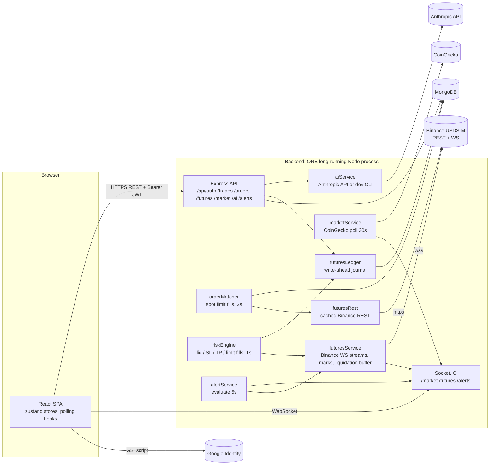

# Paperline

A crypto **paper-trading and derivatives-analytics platform**. It pulls real Binance USDS-M futures data (prices, order book, trades, funding, open interest, liquidations), turns it into a liquidation heatmap and market dashboards, adds an AI copilot (market briefs, Q&A, natural-language alert drafting), and lets users practise with **fake money**: spot trading and leveraged futures trading with TP/SL, plus price/funding/liquidation alerts.

> Nothing here moves real money. Every balance is a paper balance (new users start with $100,000). Market data is real; fills are simulated by the server at its own Binance mark price.

AI agents and new engineers: start at [`context/README.md`](context/README.md) (architecture, money rules, conventions, gotchas). This file is the human-facing overview and the deploy guide.

## Contents

1. [Features](#features)
2. [Screenshots](#screenshots)
3. [Tech stack](#tech-stack)
4. [Architecture](#architecture)
5. [Quick start](#quick-start)
6. [Environment variables](#environment-variables)
7. [AI provider setup](#ai-provider-setup)
8. [Google OAuth setup](#google-oauth-setup)
9. [API overview](#api-overview)
10. [Data model](#data-model)
11. [Security notes](#security-notes)
12. [Testing](#testing)
13. [Deployment](#deployment)
14. [Pre-launch checklist](#pre-launch-checklist)
15. [Known limitations and roadmap](#known-limitations-and-roadmap)

## Features

**Market data and analytics**
- Real Binance USDS-M data: live kline candles, order book (20 levels), trade tape, mark price and funding over Socket.IO; REST aggregations for the top-40 perpetuals overview, open interest, long/short ratios, taker buy/sell, funding history.
- **Liquidation page**: real-time liquidation feed (Binance `!forceOrder@arr` stream, buffered 24h), cross-symbol summary and coin treemap, a **liquidation map** (price-bucket estimate) and a **liquidation heatmap** (time x price canvas grid). Both are model-based estimates built from open-interest deltas and a leverage mix; exchanges do not publish real liquidation prices.
- **Derivatives page**: market table, funding strip, per-symbol open interest / long-short / taker / funding charts and simple signal readouts.
- **Markets page**: top-20 coins by market cap from CoinGecko, live over Socket.IO.
- **Stocks page** (`/stocks`, public) and the Derivatives **Real markets** panel: curated NSE stocks (incl. Tata and Aditya Birla groups, TMPV/TMCV), NIFTY 50 / BANK NIFTY / NIFTY IT, gold, silver, WTI, Brent, USD/INR, EUR/INR, GBP/INR, EUR/USD from Yahoo (unofficial, delayed, view only). Stock trading is not implemented.
- **Resilient data sources**: if Binance futures REST is blocked, candles, open interest, long/short and funding come from Bybit, Bitget, Gate or MEXC (labelled in the UI, `X-Data-Source`); no third-party price is ever used for fills, marks, liquidations, TP/SL or alerts.
- **Dashboard**: tiles (price, portfolio, open interest, funding, liquidations, alerts, sentiment), movers, recent liquidations, holdings, alert triggers.
- Command palette and a sidebar shell; per-user persisted UI state.

**AI copilot (Claude)**
- Market **brief** per symbol (structured output: headline, bias, confidence, drivers, risks, levels to watch; cached 5 min).
- **Ask** a free-form question about a symbol's data.
- **Alert parsing**: "tell me when BTC funding goes above 0.05%" becomes a validated alert draft you can save.
- **AI analyst dock**: single-shot chat about the chart you are on (crypto perp or a curated market) with source-tagged data; it can propose a **strategy** as a declarative JSON spec, which the server backtests (no look-ahead, fees and slippage included, caveats shown) and overlays on the chart. AI-written code never executes. Up to 20 saved strategies and 10 conversations per user.
- Per-user model choice (Opus 5.5, Sonnet 5.5, Haiku 5.5) in Settings, or bring your own key (Anthropic, OpenAI, Gemini, OpenRouter, custom https endpoint), plus a personal style prompt, answer length and an opt-in to share your paper portfolio with the model.
- Settings (`/settings/profile|ai|preferences|security`): avatar, preferences (ticker bar, compact tables, reduced motion, time format, landing page, alert sound/toasts), sign out everywhere, data export and account deletion.

**Paper trading**
- **Spot**: market and limit orders, holdings, average cost, 0.1% fee, $5 minimum, limit orders reserve funds and are filled by a background matcher.
- **Leveraged futures**: USDT-margined linear perpetuals, isolated margin, long/short, 1x to 50x (capped per symbol and per position-size tier), market and limit entries, add to position, partial/full close, editable **TP/SL**, automatic **liquidation** by a server-side risk engine, 0.05% taker fee. Funding is not charged.
- Exactly-once money handling for futures through a write-ahead journal (see [`context/DOMAIN.md`](context/DOMAIN.md)).
- Portfolio page: balance, holdings, futures margin, unrealised P&L, equity, trade history.

**Alerts**
- Rules on `price` (mark), `funding` (percent) or `liq_usd_5m` (USD liquidated in 5 minutes), `above`/`below`, with cooldown, evaluated every 5 s server-side and pushed live to the browser (toast, optional sound). Max 20 alerts and 5 symbols per user; events kept 30 days.

**Accounts**
- Email/password and **Google sign-in**; JWT sessions (24 h); profile and preferences; password change revokes older tokens.

## Screenshots

_Placeholder: add images under `docs/screenshots/` and link them here._

| Page | Screenshot |
|---|---|
| Trade (chart, book, tape, order card, positions) | `docs/screenshots/trade.png` |
| Liquidation heatmap | `docs/screenshots/liquidation-heatmap.png` |
| Derivatives | `docs/screenshots/derivatives.png` |
| Dashboard | `docs/screenshots/dashboard.png` |
| AI copilot brief | `docs/screenshots/copilot.png` |
| Alerts | `docs/screenshots/alerts.png` |

## Tech stack

| Layer | Choice |
|---|---|
| Backend | Node.js (CommonJS), Express 4, Socket.IO 4, Mongoose 8 (MongoDB), `ws` (Binance streams), axios, Joi (env validation), express-validator, helmet, cors, morgan, winston, bcryptjs, jsonwebtoken, google-auth-library, `@anthropic-ai/sdk` + zod |
| Frontend | React 18 (Create React App / react-scripts 5), react-router-dom 7, zustand (stores), Tailwind CSS 3, lightweight-charts (candles), chart.js, canvas (heatmaps), socket.io-client, axios |
| Data | MongoDB (local or Atlas); in-memory buffers/caches for live market data |
| External | Binance USDS-M futures (REST + WebSocket, no API key), CoinGecko (public API), Anthropic API, Google Identity Services |
| Tests | Jest (backend and CRA frontend); no supertest in practice, no React Testing Library |

## Architecture



Key points:
- The server is the only price authority. Fills use the server's Binance mark price (`tradeFill.fillPrice`: websocket mark within 3 s, else REST mark within 10 s, else 503). The client never sends a fill price.
- Market data goes through a gateway (`backend/services/marketData/`): Binance first, then Bybit, Bitget, Gate, MEXC and the Binance spot mirror, each behind its own circuit breaker and tagged in `X-Data-Source`. It is analytics only; `GET /api/market/providers` shows its health.
- Spot and futures are **separate engines** sharing one `User.balance`. Spot settles with one conditional `$inc`; futures settles through `futuresLedger` (journal, locks, per-op marker, recovery).
- Background loops (`orderMatcher`, `riskEngine`, `alertService`, `marketService`, `futuresService`) run **inside the API process**, so the backend must be a single always-on instance. See [Deployment](#deployment).

## Quick start

### Prerequisites

- Node.js 18+ (20 LTS recommended) and npm
- MongoDB 6+ running locally (`mongodb://127.0.0.1:27017`) or a MongoDB Atlas URI
- Outbound access to `fapi.binance.com` / `fstream.binance.com` (some regions, including the US, are blocked by Binance with HTTP 451) and `api.coingecko.com`

### 1. MongoDB

```bash
# option A: Docker
docker run -d --name trade-mongo -p 27017:27017 mongo:7
# option B: Homebrew
brew services start mongodb-community
```

### 2. Backend

```bash
cd backend
npm install
cp .env.example .env
# edit .env: set JWT_SECRET (>= 32 chars), e.g.
node -e "console.log(require('crypto').randomBytes(48).toString('base64url'))"
npm start            # node server.js, listens on 127.0.0.1:4000
```

`backend/.env` is git-ignored. The server refuses to start if `NODE_ENV`, `MONGO_URI` or a real `JWT_SECRET` is missing.

### 3. Frontend

```bash
cd frontend
npm install
cp .env.example .env.local     # REACT_APP_API_URL=http://localhost:4000
npm start                      # http://localhost:3000
```

`frontend/.env.development` already sets `REACT_APP_API_URL=http://localhost:4000`, so `.env.local` is only needed to override it.

### 4. Demo user

Either register in the UI (`/register`), or seed a demo guest. In `backend/.env`:

```
NODE_ENV=development
SEED_DEMO_USERS=true
DEMO_GUEST_PASSWORD=choose-a-12plus-char-password
```

Restart the backend. It creates (or resets) `guest@cryptozen.com` with that password, role `user`. In development, on loopback only, `/login` shows a "test login" card filled from `GET /api/auth/dev-hint`. Seeding never creates an admin.

### 5. Tests

```bash
cd backend  && npm test                                     # jest, 430 tests at last count
cd frontend && CI=true npm test -- --watchAll=false         # react-scripts test
```

If npm complains about its cache directory in a sandbox, add `--cache "$TMPDIR/npm-cache"` to `npm install`/`npm ci`.

## Environment variables

### Backend (`backend/.env`, loaded by `dotenv`; template: `backend/.env.example`)

| Variable | Required | Default | Purpose |
|---|---|---|---|
| `NODE_ENV` | yes | none | `development` / `production` / `test`. Gates dev-only features (CLI AI provider, `dev-hint`), the `HOST` default and production config checks (below). |
| `MONGO_URI` | yes | none | MongoDB connection string. |
| `JWT_SECRET` | yes | none | HS256 signing key, >= 32 chars (enforced in every environment); values that look like placeholders (`changeme`, `secret...`, `example`, `xxxxxx`...) are rejected at startup. |
| `ENCRYPTION_KEY` | no | derived from `JWT_SECRET` | Key for saved BYO AI keys (AES-256-GCM): 64 hex chars or base64 of 32 bytes. Invalid value fails startup (the value is never printed). Unset: HKDF from `JWT_SECRET` with one startup warning. Rotating it (or `JWT_SECRET` when unset) makes saved AI keys unreadable: `ai_key_unreadable` 409, the user re-enters the key. |
| `PORT` | no | `4000` | HTTP port. Hosts that inject `PORT` just work. Do not leave it set but empty. |
| `HOST` | no | `127.0.0.1` (`0.0.0.0` when `NODE_ENV=production`) | Bind address. Set only to override the default. |
| `TRUST_PROXY` | no | `0` | Reverse-proxy hops to trust for `req.ip` (rate-limit keys): `0`/`false`, a hop count (`1` on Render/Railway/Fly), or `true` (trusts every `X-Forwarded-For` entry, spoofable). Applied with `app.set('trust proxy', ...)` before any limiter. Invalid values fail startup. |
| `LOG_TO_FILES` | no | `true` outside production, `false` in production | `true`/`false`: also write `error.log`/`combined.log` in the cwd. Console logging is always on (JSON in production, text in development). |
| `CORS_ORIGINS` | no | `http://localhost:3000,http://localhost:3001` | Comma-separated exact browser origins for REST CORS **and** Socket.IO (no trailing slash, no wildcard). Do not leave set but empty. **Required in production** (no default; a wildcard or empty list fails startup). |
| `SEED_DEMO_USERS` | no | off | `true` seeds/refreshes `guest@cryptozen.com` (role user) on boot. **Refused in production**: `NODE_ENV=production` + `true` fails startup. |
| `DEMO_GUEST_PASSWORD` | with seeding | none | Guest password, >= 12 chars, else seeding is skipped with a warning. Also used by `dev-hint` (development only). |
| `GOOGLE_CLIENT_ID` | no | none | Google OAuth Web client ID (public). Empty disables the Google button. |
| `ANTHROPIC_API_KEY` | no | none | Enables the AI copilot via the Anthropic API. If neither this nor `ANTHROPIC_AUTH_TOKEN` is set in production, the server logs a warning and AI is disabled (the CLI provider never runs in production). |
| `ANTHROPIC_AUTH_TOKEN` | no | none | Alternative Anthropic credential (also enables AI). |
| `AI_MODEL` | no | `claude-opus-5-5` | Server default model; users may pick another from the allow-list in Settings. |
| `AI_MAX_CALLS_PER_HOUR` | no | `60` | Process-wide ceiling on billed AI calls per rolling hour (`0` blocks all). |
| `LMSTUDIO_BASE_URL` | no | `http://localhost:1234/v1` | Default LM Studio base URL when a user leaves it empty. Must be `localhost`, `127.0.0.1` or `[::1]`. |
| `LMSTUDIO_MODEL` | no | `qwen/qwen3.5-9b` | Default LM Studio model id when a user leaves it empty. |
| `LMSTUDIO_MAX_TOKENS` | no | `4096` | `max_tokens` for LM Studio calls (never below 1500): reasoning models spend tokens thinking before the answer. |
| `LMSTUDIO_REASONING_EFFORT` | no | `none` | `reasoning_effort` sent to LM Studio. `none` turns Qwen 3.5 thinking off (a thinking brief took minutes on a laptop); `low`/`medium`/`high` turn it on. |
| `ALLOW_LOCAL_LLM` | no | off | `true` allows LM Studio (loopback URLs) when `NODE_ENV=production`. Off by default: on a shared server a user-controlled loopback URL is SSRF. |
| `AI_PROVIDER` | no | unset | Code-only (not in `.env.example`). `api` forces the Anthropic API even in development, disabling the CLI provider. |
| `CLAUDE_BIN` | no | `claude` | Code-only. Path of the Claude Code CLI used by the dev-only CLI provider. |
| `BINANCE_FUTURES_REST` | no | `https://fapi.binance.com` | REST base URL (e.g. a proxy). |
| `BINANCE_SPOT_REST` | no | `https://data-api.binance.vision` | Spot mirror, the last kline fallback when every futures source fails (spot prices, so candles differ slightly). |
| `BYBIT_REST` | no | `https://api.bybit.com` | Bybit v5 public REST (no key), second in the market-data chains (used when Binance futures REST fails): perpetual candles, open interest, long/short ratio, funding, liquidation map/heatmap inputs, overview open interest. Numbers are Bybit's and differ from Binance. |
| `BITGET_REST` | no | `https://api.bitget.com/api/v2/mix/market` | Bitget USDT-M public REST (no key), after Bybit: candles, long/short ratio, funding. Analytics only. |
| `GATE_REST` | no | `https://api.gateio.ws/api/v4/futures/usdt` | Gate USDT futures public REST (no key), after Bitget: candles, open interest, ratios, taker volume, funding. Analytics only. |
| `MEXC_REST` | no | `https://contract.mexc.com/api/v1/contract` | MEXC futures public REST (no key), last exchange in the chain: candles and funding. Analytics only. |
| `YAHOO_REST` | no | `https://query1.finance.yahoo.com` | Yahoo Finance (unofficial, delayed, view only) for the curated stocks, indices, commodities and currencies. Never used for trading. |
| `BINANCE_FUTURES_WS` | no | `wss://fstream.binance.com` | WebSocket base URL. |
| `MARKET_POLL_INTERVAL_MS` | no | `30000` | CoinGecko poll interval for the Markets page. |

### Frontend (Create React App; values are inlined at **build time**)

| Variable | Default | Purpose |
|---|---|---|
| `REACT_APP_API_URL` | empty | Base URL of the backend, used for every REST call **and** Socket.IO (no trailing slash; trailing slashes are stripped once in `frontend/src/lib/apiBase.js`, which every call site imports). If empty, REST uses same-origin paths and sockets fall back to `<page origin with port replaced by :4000>`, which is wrong on any hosted domain. Files: `frontend/.env.development` (localhost:4000), `frontend/.env.production` (placeholder), `frontend/.env.example`. |

The Google client ID is **not** a frontend variable; the SPA reads it from `GET /api/auth/config`.

## AI provider setup

The AI features (`/api/ai/*`) work with one of two providers, chosen at request time by `aiService.provider()`:

1. **Anthropic API (production path).** Set `ANTHROPIC_API_KEY` (or `ANTHROPIC_AUTH_TOKEN`) in `backend/.env` and restart. Requests use structured outputs (zod), `claude-opus-5-5` by default (`AI_MODEL` to change), prompt-cached system prompts, `output_config.effort`. Check with `GET /api/ai/status` -> `{configured, model, provider: "api"}`.
2. **Claude Code CLI (development only).** When `NODE_ENV=development`, no `ANTHROPIC_*` credential is set, `AI_PROVIDER` is not `api`, and `claude auth status` reports a login, the server spawns `claude -p` (no shell, prompt on stdin, tools disabled, `ANTHROPIC_*` stripped from the child env, 120 s timeout, 2 concurrent) on the signed-in claude.ai account. `provider` reports `"cli"`. This is a convenience for local work and **never activates when `NODE_ENV` is anything other than `development`**.

Without either, AI endpoints answer `503 ai_not_configured` and the UI shows a setup hint.

**Bring your own key.** In Settings -> AI a user can pick `anthropic`, `openai`, `gemini`, `openrouter`, `custom` (any https endpoint) or `lmstudio` (local, below) instead of `default` (the server path above). Keys are encrypted at rest (AES-256-GCM, see `ENCRYPTION_KEY`), never returned (only `keySet` and the last 4 chars), and dropped from the data export. Calls go out over plain `https.request` with no redirects. A custom base URL must be https (http allowed only when `NODE_ENV=development`) and may not point at localhost, `.internal`, private, loopback, CGNAT, link-local/metadata, multicast or mapped IPv6 ranges; hostnames are checked at connect time (DNS-rebinding safe). Temperature is never sent to Anthropic, nor to OpenAI `gpt-5*`/`o*` models. Your style prompt (<= 2000 chars) goes before the server rules; the rules (data only, scenarios not certainty, "sampled"/"estimate" wording, both cases, word cap 100/180/300) and the not-financial-advice disclaimer are always appended and enforced in code. Optional "include my portfolio" adds your paper cash, holdings and open futures positions to the context.

**LM Studio (local models).** Pick `LM Studio (local)` in Settings -> AI. No key is needed (the field is hidden; a placeholder bearer is sent). Base URL defaults to `http://localhost:1234/v1` (`LMSTUDIO_BASE_URL`), model to `qwen/qwen3.5-9b` (`LMSTUDIO_MODEL`); "Fetch models" lists the chat models LM Studio has loaded (`GET /api/ai/lmstudio/models`, embedding models filtered out). The base URL may only be `localhost`, `127.0.0.1` or `[::1]` by literal text (http or https, optional port and path): userinfo, decimal/hex/mapped IP forms, other DNS names, private ranges and metadata IPs are refused, `localhost` must resolve to loopback at connect time, and redirects are not followed. It works when `NODE_ENV` is not `production`, or with `ALLOW_LOCAL_LLM=true`. Calls use a 180 s timeout, thinking off by default (`LMSTUDIO_REASONING_EFFORT`), a trimmed market-data block (the default loaded context is only 8192 tokens; overflow answers `502 ai_context_too_small`), and `max_tokens` of at least 1500 (`LMSTUDIO_MAX_TOKENS`, default 4096) because reasoning models (Qwen 3.5) think first; the Length setting still trims the visible answer. Thinking (`reasoning_content`, `<think>` blocks) is never shown; if the model spends the whole budget thinking, the API answers `502 ai_reasoning_budget`. LM Studio may forward to a model on another machine; this server only ever talks to loopback. The "include my portfolio" consent applies exactly as for other providers.

Cost and abuse controls: 10 AI requests per user per minute, a process-wide hourly budget (`AI_MAX_CALLS_PER_HOUR`), a 5-minute brief cache per symbol+model (concurrent callers share one in-flight call), failures are never cached.

## Google OAuth setup

The app uses Google Identity Services (ID-token flow): the browser gets a Google ID token, posts it to `POST /api/auth/google`, the backend verifies it against `GOOGLE_CLIENT_ID`, requires `email_verified`, and issues its own JWT.

1. Google Cloud Console -> APIs & Services -> OAuth consent screen: configure the app (External, add test users while in Testing).
2. Credentials -> Create credentials -> **OAuth client ID** -> type **Web application**.
3. **Authorized JavaScript origins**: `http://localhost:3000` and your production frontend origin (for example `https://your-app.vercel.app`, plus any custom domain). No redirect URI is needed for this flow.
4. Copy the client ID into `GOOGLE_CLIENT_ID` in the **backend** environment (it is public, not a secret) and restart the backend. The frontend fetches it from `/api/auth/config`.
5. Accounts: a first Google sign-in links an existing account with the same verified email, or creates a user with a random unusable password. Locked accounts and accounts already linked to a different Google `sub` are refused.

## API overview

Base URL: `http://localhost:4000`. "Auth" = `Authorization: Bearer <jwt>`. Errors use `{ success:false, message }` (futures adds `code`; alerts/AI/market use `{ error }`).

### Auth (`/api/auth`)

| Method | Path | Auth | Purpose | Limit (per IP unless noted) |
|---|---|---|---|---|
| POST | `/register` | no | Create account (always role `user`) | 5/hour |
| POST | `/login` | no | Email + password -> `{token, user}` | 10/min |
| POST | `/google` | no | Google ID token -> `{token, user}` | 10/min |
| GET | `/config` | no | `{googleClientId}` | none |
| GET | `/dev-hint` | no | Demo credentials; 404 unless development + seeding + loopback | 30/min |
| GET | `/verify` | yes | Validate token, return user | none |
| GET | `/me` | yes | `{user, aiModels, aiProviders, aiDefaultPrompt, aiServerRules}` (never keys or hashes) | none |
| PATCH | `/me` | yes | Update `name`, `profile`, `preferences`, `ai` (provider, model, systemPrompt, temperature, length, includePortfolio, providers model/baseUrl); keys are not settable here; unknown keys -> 422 | none |
| PUT | `/me/avatar` | yes | `{avatar}`: `emoji:<emoji>` or `data:image/jpeg\|webp;base64,...` (<= 150KB decoded, magic bytes checked) | 20/min/user |
| DELETE | `/me/avatar` | yes | Back to initials | 20/min/user |
| POST | `/password` | yes | Change password (Google-created accounts may omit `currentPassword` within 10 min of sign-in, else `REAUTH_REQUIRED`); returns a fresh token, revokes older ones | 5/min |
| POST | `/logout-all` | yes | Bump `tokenVersion`, return a fresh token for this session; other sessions and their `/alerts` sockets are dropped | 5/min/user |
| GET | `/me/export` | yes | JSON download: profile, settings (no secrets), trades, orders, positions, futures orders, alerts | 5/min/user |
| DELETE | `/me` | yes | `{confirmEmail}`: locks the account, then deletes all its data. 409 `OPEN_FUTURES` while positions are opening/open, futures orders placing/open, or ops pending/error. 500 on partial failure leaves the account locked for manual cleanup | 3/min/user |

### Spot trading

| Method | Path | Purpose | Limit |
|---|---|---|---|
| POST | `/api/trades` | Place spot order `{cryptoSymbol, type: buy/sell, amount, orderType?: market/limit, limitPrice?}` | 30/min/user |
| GET | `/api/trades?limit=` | Own trades, newest first (1..100) | none |
| GET | `/api/trades/portfolio` | `{balance, holdings:[{symbol, amount, avgCost}]}` | none |
| GET | `/api/orders` | Open spot limit orders + last 20 closed | none |
| DELETE | `/api/orders/:id` | Cancel an open limit order, release reservation | 60/min/user |

### Futures trading (`/api/futures`, all authenticated)

| Method | Path | Purpose | Limit |
|---|---|---|---|
| GET | `/config` | Fee rate, min notional, caps, leverage tiers, `fundingIgnored` | none |
| GET | `/positions` | `{positions: open (with busy, markPrice), closed: last 20}` | none |
| GET | `/orders` | `{orders: open limit entries, closed: last 20}` | none |
| POST | `/orders` | Open/add (market) or place limit entry `{symbol, side: long/short, type, size, leverage, limitPrice?, tp?, sl?}` | 30/min/user |
| PATCH | `/orders/:id` | Set/clear `tp` / `sl` on an open limit entry (price/size/leverage: cancel and re-place) | 30/min/user |
| DELETE | `/orders/:id` | Cancel a limit entry, credit the reservation | 30/min/user |
| POST | `/positions/:id/close` | Close all, or `{size}` partially, at mark | 30/min/user |
| PATCH | `/positions/:id` | Set/clear `tp` / `sl` (`null` clears) and/or change `leverage` (re-sizes isolated margin: releases or debits the difference); all applied together or none | 30/min/user |

Futures error codes: `INSUFFICIENT_BALANCE`, `MIN_NOTIONAL`, `LEVERAGE_TOO_HIGH`, `LEVERAGE_MISMATCH`, `MAX_POSITIONS`, `MAX_ORDERS`, `BAD_TPSL`, `LIQ_BREACH` (leverage change would put liq at/through the mark), `BAD_SIZE`, `UNKNOWN_MARKET`, `NOT_FOUND`, `NOT_OPEN`, `POSITION_BUSY` (retry), `NO_PRICE` (503), `OP_FAILED` (500), 422 validation, 429 limiter.

### Market data (`/api/market`, public, 120/min per IP for the whole router)

| Method | Path | Purpose |
|---|---|---|
| GET | `/market_chart/:id`, `/ohlc/:id` | CoinGecko proxies (`?days=`) |
| GET | `/futures/overview` | Top-40 perpetuals by 24h volume (mark, funding, OI USD), cached 10 s |
| GET | `/futures/symbols` | Tradable USDT perpetuals (pair picker), cached 5 min |
| GET | `/futures/klines/:symbol?interval=&limit=` | Candles (`1m,5m,15m,1h,4h,1d`, limit 1..1000), cached 10 s |
| GET | `/futures/stats/:symbol?period=` | OI, long/short, top-trader ratio, taker buy/sell, funding (`5m,15m,1h,4h`) |
| GET | `/futures/liqmap/:symbol` | Estimated liquidation levels (price buckets) |
| GET | `/futures/liqheat/:symbol?range=` | Estimated heatmap grid (`12h,24h,3d,1w`) |
| GET | `/futures/maxpain?window=&top=` | Pain field: strongest long level below / short level above price for the top N perps by volume (`window` as liqheat, `top` 1-30, default 20); 60 s cache + stale-while-revalidate, 10 req/min per IP, `skipped` counts coins left out; touch estimate is volatility-based, not a forecast |
| GET | `/futures/cvd/:symbol?interval=` (or `range=6h,24h,3d,1w`) | Cumulative volume delta from real Binance taker volume: futures `candles` plus a `spot` series (Binance spot klines), interval `1m,5m,15m,30m,1h,4h,1d`, 30 s cache; each side is `available:false` with a reason when unreachable (nothing approximated) |
| GET | `/futures/cvd/:symbol/trades?min=` | Recent Binance futures aggTrades at or above `min` USD (`10000,50000,100000,500000,1000000`), taker side, plus taker buy/sell flow of the last 60 s, `windowMs`/`count`/`medianUsd` of the fetched tape and `perMin` (15 clock minutes of buy/sell USD at or above `min`) (5 s cache) |
| GET | `/futures/liquidations` | Cross-symbol summary of the in-memory buffer (cached 2 s) |
| GET | `/futures/liquidations/:symbol` | Buffered real liquidation events `{since, events}` |
| GET | `/stocks/quotes`, `/stocks/klines/:symbol?interval=&limit=` | Curated NSE stocks (Yahoo, unofficial, delayed, view only). Display symbols only (`RELIANCE`, `TMPV`); anything off the allow-list is 404/400. Intervals `1m,5m,15m,1h,1d`; `stale: true` when the last good answer is served; 502 when Yahoo is down |
| GET | `/instruments/quotes?category=`, `/instruments/klines/:symbol` | Same for all curated markets: `stock`, `index` (`NIFTY50`, `BANKNIFTY`, `NIFTYIT`), `commodity` (`GOLD`, `SILVER`, `CRUDEOIL`, `BRENT`), `currency` (`USDINR`, `EURINR`, `GBPINR`, `EURUSD`) |
| GET | `/orderflow/heatmap/:symbol`, `/orderflow/large/:symbol` | Order Book Heatmap and Large Orders (walls + large trades) from an in-process depth collector. The `large` answer also carries `levels` (up to 40 book levels >= 5x median with `mult`/`distPct`), `activeWalls` (tracked, with `upForMs`) and `wallEvents` (the same log as the heatmap). The heatmap answer also carries the latest book ladder (20 levels a side with cumulative), spread, depth and imbalance within `band` (0.5/1/2/5 %, the covered band is reported when the snapshot is narrower) with the value ~5 min ago, tracked walls (largest per side, distance, up-for) and a wall event log (appeared/pulled/filled, max 200), and up to 300 taker-trade bubbles; query `grid` (1/2/5/10/20 x the base bucket) and `band`. Any USDT perp in the futures list (404 `no_futures` otherwise), 503 `collector_busy` when 5 coins are already collected and none is idle >30 s; `status` `collecting`/`ok`/`thin`/`stale`/`unavailable`; extra limit 40/min per IP |
| GET | `/providers` | Health of each data source: name, capabilities, breaker state, listed-symbol count (no URLs or errors) |

### News headlines (`/api/news`, public, 60/min per IP)

| Method | Path | Purpose |
|---|---|---|
| GET | `/api/news?limit=30&category=all\|crypto\|india` | Headlines with a short summary and image (`{items:[{id,title,link,source,category,publishedAt,image,summary}], sources:[{name,category,ok,at}], stale?, disclaimer}`), from 3 crypto and 3 Indian-markets RSS feeds; limit 1..50; cached 10 min; `stale: true` when every source fails and an older answer is served (up to 24 h); 502 `News unavailable` otherwise. `X-Data-Source: rss`. Titles are text-only, links http(s) only. `summary` is plain text, snippet capped at 200 chars (`''` if none); `image` is a hotlinked, publisher-owned https URL or `null` (we never copy or proxy the bytes); no full text. Publisher terms for snippets and images are still to be checked manually. External headlines, not our analysis, not investment advice. |
| GET | `/api/news/:id` | One headline by its 12-hex `id`, looked up in the full merged cached list (not limited to 50 or a category): `{item:{id,title,link,source,category,publishedAt,image,summary}, disclaimer}`. 404 `{error:'not found'}` for an unknown or malformed id; 502 `News unavailable` when no data. Same 60/min limit and `X-Data-Source: rss`. |

Every futures response carries `X-Data-Source`: `binance-futures` (default), `ws`, `bybit`, `bitget`, `gate`, `mexc`, `spot`, `unavailable` or `yahoo`. Anything other than `binance-futures` is third-party or reduced data and the UI says so. `/futures/liqheat` adds `partial: true` when the history is shorter than the range (new listing). Third-party data is analytics only: fills, marks, liquidations, TP/SL and alerts use Binance prices only.

Symbols in `/api/market/*`, `/api/ai/*` and alerts are **full futures symbols** (`BTCUSDT`); trading routes use the **base ticker** (`BTC`).

### AI (`/api/ai`, authenticated)

| Method | Path | Purpose |
|---|---|---|
| GET | `/status` | `{configured, model, provider}` |
| GET | `/brief/:symbol` | Structured market brief (cached 5 min) |
| POST | `/ask` | `{symbol, question (3..500 chars)}` -> `{answer}` |
| POST | `/alerts/parse` | `{text (3..300 chars)}` -> `{draft}` or 422 |
| PUT | `/keys/:provider` | `{apiKey}` (8..300 chars) -> `{provider, keySet, keyLast4}`; 20/min/user |
| DELETE | `/keys/:provider` | Remove the saved key |
| POST | `/test` | `{provider}` -> `{ok, provider, model, latencyMs, models?}` using the saved key/model/baseUrl; `models` (same shape as `/models`) is added when the provider's list call also works |
| POST | `/models` | `{provider, apiKey?, baseUrl?}` -> `{models: [{id, name, contextLength?, pricePerMTokIn?, pricePerMTokOut?, free?}]}`; a typed `apiKey` is used for this one call and never stored, otherwise the saved key and saved base URL are used; 10/min/user; errors `ai_no_key`, `ai_auth_failed`, `ai_rate_limited`, `ai_unreachable`, `ai_bad_response` |
| GET | `/lmstudio/models` | `{models: [id]}`: chat models loaded in the user's LM Studio (saved base URL or default) |
| POST | `/agent/chat` | `{context: {kind: perp/instrument, symbol, page, interval?}, message (1..1000), conversationId?, wantStrategy?}` -> `{conversationId, reply, disclaimer}`. Single-shot analyst, no tools; it may return a strategy spec (inert JSON). A trade-intent message (trade, strategy, bot, go ahead, make $N...) runs in strategy mode even with `wantStrategy` off (`reply.strategyMode`: `on`/`auto`/`off`). `reply.structured` (verdict, headline, plan, levels, bull/bear/risks) is optional and server-checked; `reply.text` is always present. Nothing runs until the user accepts on the bot screen |
| GET | `/agent/conversations`, `/agent/conversations/:id` | Own conversations (max 10, 40 messages each, expire after 30 days) |
| DELETE | `/agent/conversations/:id`, `/agent/conversations` | Delete one / all own conversations |

AI-written code never executes. Strategies are a strict declarative JSON spec evaluated by the server.

### Strategies (`/api/strategies`, authenticated)

| Method | Path | Purpose | Limit |
|---|---|---|---|
| POST | `/validate` | `{spec}` -> `{spec, describe}` or 422 `invalid_spec` | 60/min/user |
| POST | `/evaluate` | `{spec` or `strategyId, kind: perp/instrument, symbol, limit?, costs?: {slippagePct}}` -> stats, trades, markers, series, caveats, `candlesSource`. The server fetches candles; client candles are rejected | 30/min/user |
| GET | `/`, `/:id` | Own strategies | none |
| POST | `/` | `{spec, name?, symbol?, origin?: ai/user}` (max 20, 409 `STRATEGY_LIMIT`) | none |
| PUT | `/:id` | Update `name`, `spec`, `symbol` | none |
| DELETE | `/:id` | Delete | none |

Backtest rules: signal on bar i fills at the open of bar i+1, stop is checked before target within a candle, fee 0.05% per side and slippage 0.02% by default, one position, fixed size, no compounding. Results are hypothetical and in-sample; the caveats are always returned.

Per user: 10 requests/min across brief/ask/parse/test/lmstudio models and agent chat; agent chat on the server's own key is also capped at 60/day. Process-wide hourly budget `AI_MAX_CALLS_PER_HOUR` applies only to the `default` provider. Error codes: `ai_no_key` 400, `ai_bad_base_url` 400, `ai_no_model` 400, `ai_local_disabled` 400 (LM Studio in production without `ALLOW_LOCAL_LLM`), `ai_key_unreadable` 409, `ai_rate_limited` 429, `ai_not_configured` 503, `ai_auth_failed` / `ai_unreachable` / `ai_upstream_error` / `ai_reasoning_budget` 502 (`ai_auth_failed` is 502 on purpose: the SPA signs out on any 401).

### Alerts (`/api/alerts`, authenticated, 60/min/user)

| Method | Path | Purpose |
|---|---|---|
| GET | `/` | Own alerts with live `status` (`watching` / `no_data`) |
| GET | `/events?limit=` | Recent triggers (1..200, default 50) |
| POST | `/` | Create `{symbol, metric: price/funding/liq_usd_5m, op: above/below, value, note?, cooldownMin?}` (max 20 alerts, 5 symbols) |
| PATCH | `/:id` | Update `active`, `value`, `note`, `cooldownMin` |
| DELETE | `/:id` | Delete |

### Socket.IO namespaces

| Namespace | Auth | Client -> server | Server -> client |
|---|---|---|---|
| `/market` | none | none | `market:update` (top-20 CoinGecko list; snapshot on connect) |
| `/futures` | none | `futures:subscribe {symbol}`, `futures:unsubscribe {symbol}` (max 3 symbols per socket, 50 per server) | `futures:kline` (1m), `futures:mark`, `futures:book`, `futures:trades`, `futures:liquidation`, `futures:error` |
| `/alerts` | JWT in `handshake.auth.token` | none | `alert:triggered` to room `user:<id>` |

## Data model

| Collection (model) | Purpose | Key fields |
|---|---|---|
| `User` | Account, paper cash, spot holdings | `username`, `email`, `password` (bcrypt), `googleId?`, `role`, `balance` (USD, default 100000), `holdings` (Map base -> amount), `futuresOps` (idempotency markers), `preferences`, `profile`, `ai.model`, `lockedAt?`, `passwordChangedAt?` |
| `Trade` | Spot fill history | `userId`, `cryptoSymbol`, `type`, `amount`, `priceAtTrade`, `fee`, `orderId?` |
| `Order` | Spot limit orders | `symbol`, `side`, `amount`, `limitPrice`, `reserved`, `status` (open/filled/cancelled/rejected/error) |
| `Position` | Futures isolated position | `symbol`, `side`, `size`, `entryPrice`, `leverage`, `margin`, `mmr`, `liqPrice`, `tp`, `sl`, `status`, `activeKey` (unique sparse), `lockOp`, `rev`, `realizedPnl`, `fees` |
| `FuturesOrder` | Futures limit entry orders | `symbol`, `side`, `size`, `leverage`, `limitPrice`, `reserved`, `status` |
| `FuturesOp` | Write-ahead journal for futures money ops | `kind`, `targets`, `deltaCents`, `post`, `status` (pending/done/rolled_back/error), `attempts` |
| `Alert` / `AlertEvent` | Alert rules / trigger history (TTL 30 days) | `metric`, `op`, `value`, `cooldownMin`, `lastTriggeredAt` |
| `Liquidation` | Persisted realised liquidation events (TTL 2 days) | `symbol`, `side`, `price`, `qty`, `usd`, `ts` |

Money units: spot and futures engines compute in **integer cents**; stored dollar fields are `cents / 100`. Details in [`context/DOMAIN.md`](context/DOMAIN.md); the original futures design is [`docs/phase2-leverage.md`](docs/phase2-leverage.md) (where code and doc differ, the code wins: for example `Position.rev` exists in code only).

## Security notes

What is in place:
- **JWT** HS256, 24 h, payload `{userId, role}`. The auth middleware pins `algorithms: ['HS256']` and re-reads the user on **every** request: a deleted user, a `lockedAt` account, or a token issued before `passwordChangedAt` is rejected (this is the revocation mechanism). Socket.IO `/alerts` applies the same check.
- Passwords: bcrypt (cost 10), 8..72 chars; login does one bcrypt compare even for unknown emails (no timing oracle); generic "Invalid email or password".
- `role` is never read from request bodies; admins are set in the database. Legacy public accounts (`admin@cryptozen.com`, and the guest unless seeding is on) are locked at boot.
- Input validation: express-validator with strict types and unknown-key rejection on `PATCH /me` and futures routes; `:id` params must be 24-hex; symbols are regex-checked before reaching any Mongo update path.
- `helmet`, `express.json({limit:'100kb'})`, CORS allow-list, Socket.IO `allowRequest` origin check, morgan logs no bodies/headers, winston redacts secrets and drops request/response objects.
- **Rate limits** (in-memory sliding window, see the API tables; IPv6 keyed per /64).
- Server-side prices only; users can only act on their own documents (other users' ids return 404).

Dev-only gates (all depend on `NODE_ENV=development`): the `GET /api/auth/dev-hint` credentials endpoint (also needs `SEED_DEMO_USERS=true`, a 12+ char `DEMO_GUEST_PASSWORD` and a loopback socket), and the Claude CLI AI provider. Marked `DEV ONLY: delete when hosted` in `routes/authRoutes.js`, `controllers/authController.js` and `frontend/src/pages/Login.js`.

**What must change or be decided before production** (also in the [checklist](#pre-launch-checklist)):
- Set `NODE_ENV=production`, a fresh random `JWT_SECRET`, `CORS_ORIGINS` = your real frontend origin(s) only; never reuse local secrets. `SEED_DEMO_USERS=true` is refused in production (startup fails); `dev-hint` stays development-only.
- Set `TRUST_PROXY` (usually `1`) on Render/Railway/Fly: without it every client shares the proxy's IP, so per-IP limits (login 10/min, register 5/hour) become one global bucket. Verify with two clients on different networks.
- The JWT lives in `localStorage` (XSS-readable); no refresh tokens, no email verification, no password reset, no CAPTCHA.
- Market routes (`/api/market/*`) are public and proxy upstream APIs; they are rate-limited per IP only.
- Production logging: winston always logs JSON to the console (stdout) so platform log viewers work; log files are off in production unless `LOG_TO_FILES=true` (ephemeral on most hosts).
- Production startup checks (fail fast, messages name keys never values): `JWT_SECRET` >= 32 chars and not a placeholder, `CORS_ORIGINS` set with no wildcard, `SEED_DEMO_USERS` not `true`. A missing `ANTHROPIC_API_KEY` only warns.
- `.env` is git-ignored (`backend/.gitignore`), but `frontend/.env.production` and `.env.development` are committed; they must only ever hold public values (the API URL).

## Testing

| Where | Command | Notes |
|---|---|---|
| Backend | `cd backend && npm test` | Jest; `tests/setupEnv.js` injects dummy `NODE_ENV/MONGO_URI/JWT_SECRET` and ignores `backend/.env`. Tests use in-memory fakes of the Mongoose models, not a database, and no `supertest` (a small in-process dispatcher is used in `futuresApi.test.js`). 705 tests passing at last count (2026-11-21); frontend 35 suites / 179 tests passing. |
| Frontend | `cd frontend && CI=true npm test -- --watchAll=false` | react-scripts/Jest, DOM tests via `react-dom/test-utils` + `createRoot` (no React Testing Library). At last run 27 suites / 128 tests passed and 3 suites (`Market`, `Liquidation`, `SymbolLiquidations`) failed to load with `Cannot use import statement outside a module` (the ESM build of axios pulled in through `lib/api.js`); treat as a known open issue, see [`context/TODO.md`](context/TODO.md). |
| Frontend build | `cd frontend && npm run build` | With `CI=true` (typical on Vercel and CI) **warnings are errors**: an unused import or hook-deps warning fails the build. |

## Deployment

Target topology:

```
Browser --> Vercel (static React build, SPA rewrite)
   |
   +--HTTPS REST + WSS--> Long-running Node host (Render / Railway / Fly) --> MongoDB Atlas
                                                          |
                                                          +--> Binance, CoinGecko, Anthropic
```

### Frontend on Vercel

1. Import the repo in Vercel. **Root Directory: `frontend`**.
2. Framework preset: **Create React App** (auto-detected). Build command `npm run build`, output directory `build`, install command `npm install`.
3. Environment variables (Project Settings -> Environment Variables, for Production and Preview):
   - `REACT_APP_API_URL=https://<your-backend-host>` (no trailing slash). It is used for REST and for Socket.IO.
   - Do **not** put secrets in `REACT_APP_*` variables; they are public in the bundle. CRA inlines them at build time, so changing one needs a **redeploy**.
4. `frontend/vercel.json` (already in the repo) rewrites every path to `/index.html` so deep links like `/trade?symbol=ETH` and a refresh on `/portfolio` work, caches `/static/*` immutably, and adds basic security headers. It deliberately sets no Content-Security-Policy and no Cross-Origin-Opener-Policy because Google Identity Services (popup/iframe/script) and cross-origin sockets would need a carefully tuned policy.
5. Hosted builds (Vercel and most CI) typically run with `CI` set, and Create React App then treats warnings as errors, so an ESLint warning fails the build. Run `CI=true npm run build` locally first.
6. After you know the Vercel URL, add it to the backend `CORS_ORIGINS` and to the Google OAuth **Authorized JavaScript origins**. Preview deployments get new URLs each time: either add them or test previews against a staging backend.

### Backend: Render / Railway / Fly

**Do not deploy the backend to Vercel serverless (or any function platform).** It needs, in one process: persistent Socket.IO WebSocket connections, outbound WebSocket connections to Binance with in-memory marks and a 24 h liquidation buffer, the in-process risk engine (1 s), spot order matcher (2 s) and alert evaluator (5 s), and in-memory rate limiters. Serverless instances are short-lived and plural, so liquidations and limit fills would stop or double-run.

Settings (any of the three):

| Setting | Value |
|---|---|
| Runtime / root | Node 18+, root directory `backend` |
| Install / start | `npm ci` (or `npm install`) / `npm start` |
| Instances | **Exactly 1.** No autoscaling, no multi-region. |
| Env | `NODE_ENV=production`, `TRUST_PROXY=1`, `MONGO_URI` (Atlas SRV string), `JWT_SECRET`, `CORS_ORIGINS=https://<your-vercel-domain>[,https://<custom-domain>]`, `GOOGLE_CLIENT_ID`, `ANTHROPIC_API_KEY` (optional), `PORT` is injected by the host (the app reads it); `HOST` defaults to `0.0.0.0` in production |
| Region | **Not in the US.** Binance returns HTTP 451 to many US IPs; the API then answers `502 Binance blocks this server's region`. Pick EU or Asia (for example Frankfurt or Singapore), and test `/api/market/futures/overview` after the first deploy. |
| Health check | `GET /api/health` (public, no auth, no secrets): 200 `{ok:true, uptime, mongo:"up" or "down"}`; it answers 200 even when Mongo is down. |
| Persistent disk | Not needed (no uploads; logs are disposable). |

Deploy semantics, from the code (`server.js`, `riskEngine.js`): **stop-then-start, never overlap.** Two live risk engines would race on ledger recovery and could roll back an operation mid-flight. On SIGTERM the process waits up to 5 s for an in-flight settle and exits; the new process only recovers ops older than 15 s. So configure the host to stop the old instance before starting the new one (no zero-downtime/rolling overlap). Host knobs are not verified here; check the current docs: Render (zero-downtime deploys are the default, look for a way to disable overlap), Railway (deployment overlap/draining settings), Fly (`strategy = "immediate"` in `fly.toml` `[deploy]`, single machine, no autostop). A few seconds of downtime per deploy is the intended trade-off; the frontend polls and reconnects sockets automatically.

Also on the host:
- **MongoDB Atlas**: create a cluster (a free M0 works for a demo), a database user, and a network access rule. The backend host's egress IPs are usually not static on Render/Railway, so for an MVP you may have to allow `0.0.0.0/0` and rely on a strong password; use static IPs or private networking when available. Use the SRV connection string in `MONGO_URI`. Indexes (including TTL indexes) are built automatically by Mongoose on boot.
- **WebSockets**: all three platforms proxy WebSocket upgrades on the normal HTTPS port; the client connects with `transports: ['websocket','polling']`.
- **Logs**: in production the app logs to files only (`error.log`, `combined.log` in the working directory) and not to stdout, so the platform's log tab will be empty. Either add a console transport in `config/logger.js` (not done) or ship the files elsewhere.
- **Secrets**: set them in the host dashboard, never in the repo.

### Keepalive (Render free tier)

`.github/workflows/keepalive.yml` pings `https://cryptozen-api.onrender.com/api/health` every 5 minutes (and on manual dispatch) so the free web service does not sleep; a sleeping instance pauses limit orders, TP/SL and liquidations. Limits: GitHub cron can lag 5-15 minutes and GitHub pauses scheduled workflows after 60 days without repo activity (re-enable in the Actions tab, or use cron-job.org). The URL is hardcoded in the workflow: edit it if the backend moves.

### CORS

- REST: `cors({ origin: CORS_ORIGINS })`, exact string match against the request `Origin` header.
- Socket.IO: same list, plus an `allowRequest` check that rejects browser origins not on the list (requests with no `Origin`, such as curl or server clients, are allowed).
- Include scheme and host exactly as the browser shows it: `https://app.example.com`, no trailing slash, no path. A custom domain and the `*.vercel.app` domain are two different origins.
- Symptom of a mismatch: REST calls fail with a CORS error in the browser console and the sockets stay in `connecting`/`error`.

## Pre-launch checklist

- [ ] `NODE_ENV=production`, fresh `JWT_SECRET` (48+ random bytes), no placeholder values.
- [ ] Backend reachable over HTTPS (`HOST` defaults to `0.0.0.0` in production); `TRUST_PROXY=1` set; platform health-check path is `GET /api/health` (`{ok, uptime, mongo: up or down}`, public, 200 even if Mongo is down); frontend `REACT_APP_API_URL` points at it and the app was **rebuilt** after setting it.
- [ ] `CORS_ORIGINS` lists exactly the production frontend origin(s); verify login, a market order and the live chart from the deployed frontend.
- [ ] `TRUST_PROXY` set (usually `1`) and rate limiting verified per client.
- [ ] Backend region is not blocked by Binance; `/api/market/futures/overview` returns data.
- [ ] Exactly one backend instance; deploys are stop-then-start.
- [ ] MongoDB Atlas: strong user password, network access decided, backups on, connection string in the host's secrets.
- [ ] `SEED_DEMO_USERS` is off (or consciously on with a strong `DEMO_GUEST_PASSWORD`); no real accounts use the seeded guest.
- [ ] Review any `role: admin` users in the database (startup logs a SECURITY warning if some exist).
- [ ] Google OAuth: production origin added to Authorized JavaScript origins; `GOOGLE_CLIENT_ID` set on the backend; consent screen published if needed.
- [ ] AI: `ANTHROPIC_API_KEY` set (or AI left off); `AI_MAX_CALLS_PER_HOUR` set to a budget you accept; CLI provider cannot activate (`NODE_ENV=production`).
- [ ] Logging: a way to see backend errors in production (console transport or log shipping).
- [ ] No secret committed: `git ls-files | grep -i env` shows only `.env.example` / the frontend public-value env files; rotate anything that ever leaked.
- [ ] `CI=true npm run build` passes locally; backend and frontend tests are green.
- [ ] Decide on the dev-only code (`dev-hint` route and Login card) and remove it if you prefer not to ship it (it is inert unless `NODE_ENV=development`).
- [ ] UI states clearly that this is paper trading with simulated fills and no funding.

## Known limitations and roadmap

Limitations (by design or not yet done):
- Paper trading only; fills happen at the server mark price, no slippage, no order-book matching. Funding is never charged. No cross margin, no leverage change on an open position, no reduce-only limit exits, no trailing stops, no hedge/netting modes beyond one long and one short per symbol.
- Spot only trades symbols that exist as Binance USDT perpetuals (`BTC` -> `BTCUSDT`); the price source is the futures mark.
- Liquidation map and heatmap are estimates from open-interest changes and an assumed leverage mix. Liquidation feed data is sampled (Binance throttles the stream) and the in-memory buffer only covers the time since the server started (plus up to 24 h reloaded from Mongo).
- Local models (LM Studio) work only when the backend runs on your own machine: a hosted server cannot reach your `localhost` (`ALLOW_LOCAL_LLM` exists but does not help remotely).
- Yahoo data is unofficial and delayed; stocks, indices, commodities and currencies are view-only (no INR ledger, no NSE sessions, no trading yet).
- Strategy backtests are hypothetical and in-sample, not a prediction.
- Single process: in-memory rate limits, caches, liquidation buffer, risk engine and matchers; no horizontal scaling and no leader election.
- No email verification, password reset, refresh tokens or 2FA; JWT in `localStorage`.
- Frontend: Create React App (unmaintained upstream); some legacy files are unused (`CompanyDash.jsx` and the `company/` components); default CRA `index.html` title/description; marketing copy on `/` is placeholder.
- Futures journal (`FuturesOp`) has no TTL; limit-order and position count caps use count-then-insert and can overshoot by a few under parallel requests.

Roadmap ideas: Redis-backed limiter and a leader lock to allow more than one instance, push events for liquidations/TP/SL instead of 3 s polling, funding simulation, cross margin, leaderboard/competitions, migrate off CRA (Vite), production-grade session handling (httpOnly cookies). Tracked in [`context/TODO.md`](context/TODO.md).
